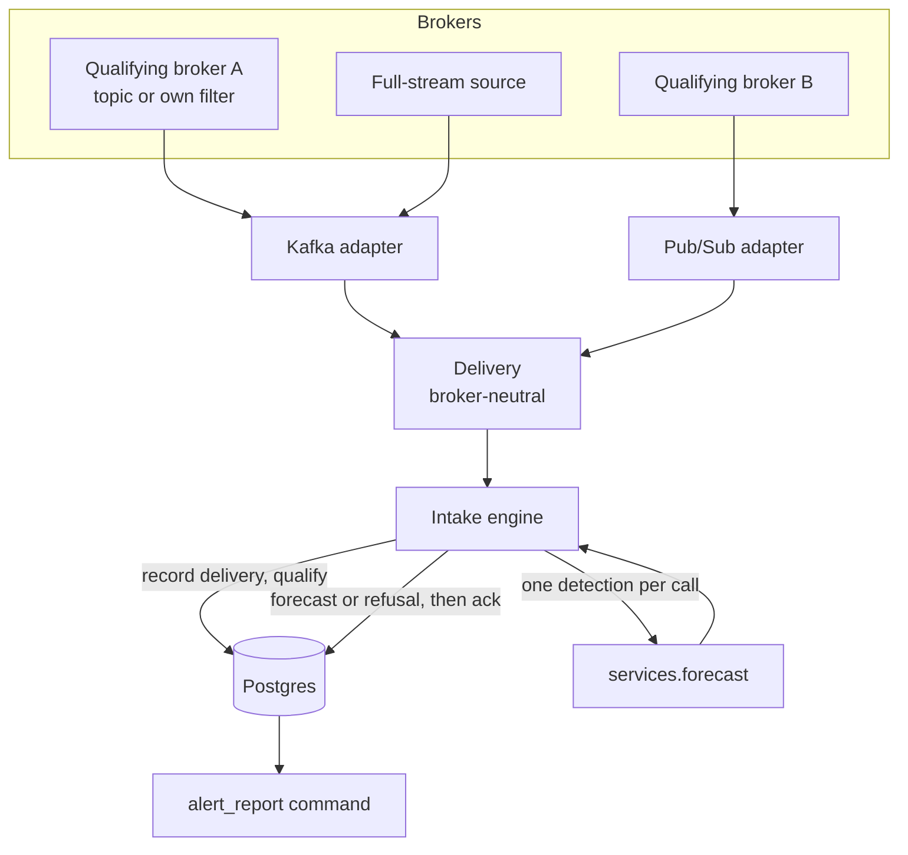
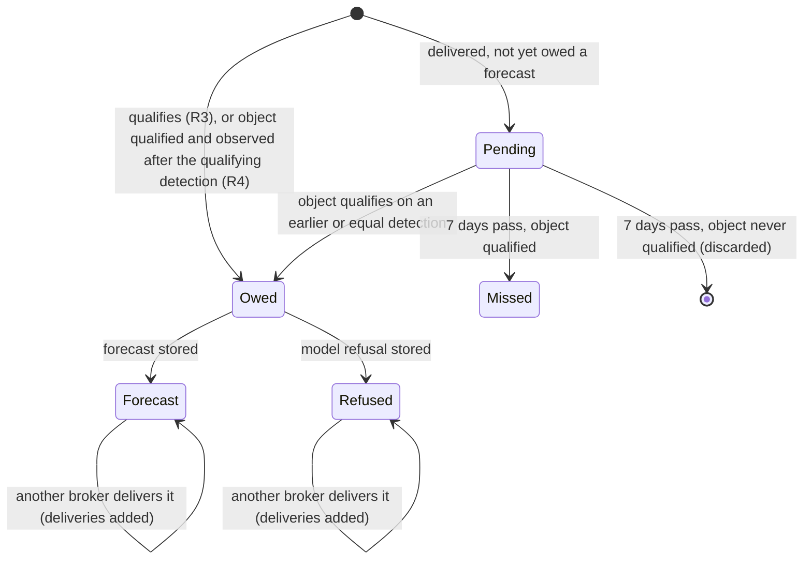

# Alert Intake and Filtering - Plan

## Goal Capsule

- **Objective:** The SELDON team can see, within minutes, a SELDON forecast for every likely supernova delivered by any of the brokers it subscribes to, and every forecast is kept so it can later be compared with what the object actually did.
- **Means:** A long-running consumer process takes alerts from qualifying brokers and one full-stream source, applies the qualification rule itself, forecasts one detection per call, and stores each result in Postgres (KTD2, KTD3, KTD4).
- **Product authority:** `STRATEGY.md`, the Alert intake and filtering track. This plan covers only the alert path of that track. Researcher-submitted photometry, band mapping for other instruments, the Distribution track (Hopskotch broadcast and web/REST/MCP), and models other than SELDON are not active scope.
- **Stop conditions:** Stop and report rather than building around it if U1 finds fewer than two brokers that meet R1, if the LSST flux zero point cannot be confirmed, or if one process at the measured per-forecast cost cannot meet the 10-minute latency target at U1's estimated steady-state forecast rate.
- **Execution profile:** One pull request. U1 runs first and gates U3-U8; U2 can run alongside it. `ce-work` executes; per the project `CLAUDE.md`, the branch is pushed to `bot` and the PR opened on `scimma/seldon-service`. The deployment repository is not touched.
- **Open blockers:** None for credentials: as of 2026-11-13 the service holds its own credentials for Fink, Pitt-Google, AMPEL on Hopskotch, and Babamul (DEV), in the gitignored `docker/secrets/`, and owns a Lasair filter (see Pre-U1 broker probe). Still open: which source fills the full-stream role, since Pitt-Google's is paid (Pre-U1 broker probe).

---

## Product Contract

_Product Contract preservation: changed - R1 (access widened to service-owned broker filters, user-directed this session; qualifying brokers named as such), R4 (clarified: "later" means later in observation time, bounded by a seven-day window, as confirmed in the plan's scoping summary), R6 (exactly once per checkpoint, as confirmed in the same summary); added R14 (forecast grid) and R15 (full-stream source), both user-chosen this session; added AE7 and AE8 to illustrate R4; Outstanding Questions resolved into Key Technical Decisions. All other requirements, IDs, and Key Decisions carried forward unchanged._

### Summary

The service consumes Rubin alerts continuously from at least two brokers that publish an SN-like score and the alert's light curve, plus one source that carries every detection.
A detection that clears any one broker's reliability cut and SN-like threshold is forecast with the pinned SELDON checkpoint, and so is every later detection of that object.
Each forecast is stored with the alert it came from, the broker and score that qualified it, its regime mark, and model provenance, for the team to inspect.

### Problem Frame

SELDON's developers have no view of how their model behaves on real Rubin objects as they appear.
They do not do this today at all: no one pulls live light curves and runs the checkpoint on them, so there is no record of how early, pre-peak forecasts perform and no way to compare one release against the next on the same objects.

The raw stream is large.
The SCiMMA crossmatch service, which already ingests ANTARES, Lasair, and Pitt-Google with a reliability cut of 0.6, recorded 58,162 distinct Rubin objects over the seven nights ending 2026-11-11, from 1,544 to 27,802 a night, 92% of them delivered by more than one broker.
Reliability says a detection is real, not what it is, so a supernova-trained model needs a second, type-aware cut before forecasts mean anything.
CPU cost is not the constraint: the measured forward pass is 0.08-0.32 s per object on one thread.

### Key Decisions

- **Alert path first; submitted photometry later.** The strategy ranks alert-stream forecasts first. (session-settled: user-approved - chosen over the submitted-photometry path or both together: the two share little beyond the forecast call.)
- **Take each broker's alerts through whatever it publishes, including a service-owned filter where that is the only access.** Lasair offers no stream except per-user filters, and the brokers with SN-like scores publish them on broker-defined topics. (session-settled: user-directed - chosen over broker-defined topics only, and over unfiltered full streams only: either would leave too few qualifying brokers; reusing the crossmatch service's intake stays rejected because it holds neither light curves nor classification scores.) Governs R1, R2.
- **A full-stream source supplies later detections.** SN-score topics only carry detections that pass the broker's own filter, so later detections of a qualified object may never arrive from them. (session-settled: user-approved - chosen over a watch-list filter inside a broker, or forecasting only what qualifying brokers send.) Governs R4, R15.
- **An SN-like score decides; reliability gates.** (session-settled: user-approved - chosen over reliability alone or either signal alone: reliability alone forecasts variable stars and AGN at tens of thousands a night.) Governs R3.
- **Brokers are chosen by a rule, not a list.** (session-settled: user-approved - chosen over matching the crossmatch service's three brokers, not all of which publish an SN-like score.) Governs R1.
- **Any one broker qualifies a detection.** Misses the fewest supernovae and adds no wait for a second broker. (session-settled: user-approved - chosen over requiring agreement or combining scores into one.) Governs R3.
- **Forecast every later detection of a qualified object, and once qualified an object stays in.** Keeps each object's forecast history unbroken so it can be scored over the whole light curve. (session-settled: user-approved - chosen over once per object, once per night, or re-checking the score at each detection.) Governs R4, R6.
- **Sparse light curves are forecast and stored, marked.** Pre-peak objects rarely have the checkpoint's 32 training points, and early behavior is exactly what the team cannot see today. (session-settled: user-approved - chosen over a minimum observation count or discarding sparse forecasts.) Governs R8.
- **Forecasts cover all six bands from first detection to 60 days past the latest.** Covers the rise, peak, and early decline for most supernovae. (session-settled: user-approved - chosen over observed bands only, or deferring to the SELDON team's evaluation grid.) Governs R14.
- **Work stops at stored, inspectable forecasts.** Storage is needed anyway for the accuracy metric, and Distribution builds on it. (session-settled: user-approved - chosen over adding a minimal Hopskotch broadcast now, or stopping before forecasting.) Governs R11.
- **Forecast from the light curve that arrives with the alert.** No separate fetch of fuller history; this is the scope as stated for the service. Governs R7.
- **Fink and Lasair are the first qualifying brokers; Pitt-Google is optional.** Both are free and both carry reliability, an SN-like signal, and a light curve with identifiers on every point (Pre-U1 broker probe). Pitt-Google also qualifies, but its Pub/Sub subscriptions are billed to the service's Google Cloud project and may become unaffordable, so the plan must not depend on it. (session-settled: user-directed, 2026-11-13 - chosen over Pitt-Google plus Fink, because of cost.) Governs R1.
- **Lasair's SN-like signal is Sherlock's host-context class, for now.** The service's Lasair filter passes objects that Sherlock classes `SN` or `NT` (nuclear transient, which keeps TDEs in). This is a contextual class from the object's position relative to catalogued galaxies, not a light-curve classifier. Revisit once forecasts accumulate: compare Lasair-qualified objects with Fink-qualified ones, and consider adding a Lasair annotator score (for example LVRA) to the filter. (session-settled: user-approved, 2026-11-13 - chosen over requiring an annotator score now.) Governs R3.
- **Lasair's reliability cut is `objects.latestR >= 0.6`.** It matches the crossmatch service's moderate Lasair cut. Every point in the full alert carries its own `reliability`, so stricter cuts remain possible on the service side. (session-settled: user-approved, 2026-11-13.) Governs R3, R5.

### Requirements

**Intake**

- R1. The service consumes alerts continuously from at least two qualifying Rubin brokers, each of which publishes, for LSST alerts, a reliability score, an SN-like classification score, and the detection's light curve, through a broker-defined topic or a service-owned filter.
- R2. Adding or removing a qualifying broker changes nothing about how detections are qualified, forecast, or stored.
- R15. The service also consumes at least one source that delivers every LSST detection, so later detections of qualified objects reach it; such a source never qualifies a detection.

**Qualification**

- R3. A detection qualifies when a single broker's reliability score and SN-like score for it both meet that broker's own reliability cut and SN-like threshold.
- R4. Once any detection of an object has qualified, every detection of that object observed after it is forecast, whatever its later scores; a detection delivered more than seven days before its object qualifies is recorded as missed instead.
- R5. Each broker's reliability cut and SN-like threshold are settings that can change without code changes, and the values in effect are stored with every forecast.

**Forecasting**

- R6. Each qualifying detection is forecast exactly once per checkpoint, however many brokers deliver it.
- R7. A forecast uses the light curve carried by the alert that delivered the detection, with nothing added from other sources.
- R8. A detection is forecast regardless of how few observations its light curve holds; a forecast below the checkpoint's training minimum is stored with its regime mark set.
- R9. A detection the model refuses is recorded with its rejection reason, and the refusal does not stop any other detection from being forecast.
- R14. Each forecast is evaluated in all six LSST bands, daily, from the object's first detection to 60 days after the latest detection in its light curve.

**Storage and inspection**

- R10. Each stored forecast records the Rubin object and detection it belongs to, this detection's delivering brokers with their scores and delivery times, the forecast output with its regime mark and provenance, and when the forecast was stored.
  It also records the object's qualifying event: the detection, broker, and score that qualified the object, with that broker's reliability cut and SN-like threshold in effect at the time.
  It also records the exact light curve passed to the forecast call, with the zero point supplied, so later scoring and re-forecasting need nothing from the brokers.
- R11. The team can inspect stored forecasts and refusals internally; nothing is published outside the service.
- R12. Stored forecasts are kept with no retention limit, so each one can later be compared with the photometry that subsequent detections of the same object bring.

**Continuity**

- R13. After the service has been down, it resumes from where each broker's stream allows, and the periods it could not recover are visible rather than silently skipped.

### Acceptance Examples

- AE1. **Covers R3, R6.** **Given** detection D arrives from broker A with SN-like score below A's threshold, **when** broker B later delivers D with a score above B's threshold, **then** D is forecast once, recorded as qualified by B, and its latency is measured from B's delivery.
- AE2. **Covers R6.** **Given** D has already been forecast, **when** a third broker delivers D, **then** no second forecast is made and the third broker is added to D's delivering brokers.
- AE3. **Covers R4, R15.** **Given** object O qualified on its second detection, **when** its fifth detection arrives with every broker's SN-like score below threshold, **then** the fifth detection is forecast and stored with those below-threshold scores.
- AE4. **Covers R8.** **Given** a qualifying detection whose light curve has 4 usable observations, **when** it is forecast, **then** the forecast is stored with its regime mark showing sparse and outside the training regime.
- AE5. **Covers R9.** **Given** two qualifying detections arrive together and one carries a band the checkpoint does not know, **when** they are processed, **then** the other is forecast and stored and the refused one is recorded with its rejection reason.
- AE6. **Covers R13.** **Given** the service was stopped for six hours and broker A retains only the last two hours, **when** it restarts, **then** it processes A's retained two hours and records the four unrecoverable hours for A.
- AE7. **Covers R4.** **Given** detection D2 of object O arrived from the full-stream source and was not forecast, **when** a broker's late score for O's earlier detection D1 qualifies O within seven days, **then** D1 and D2 are both forecast.
- AE8. **Covers R3, R4.** **Given** a broker publishes a detection's light curve and its SN-like score as separate messages, **when** the score arrives after the light curve, **then** the detection qualifies on the score's arrival and is forecast from the light curve already received.

### Success Criteria

- 90% of forecasts outside a post-outage replay are stored within 10 minutes of the broker publishing the delivery that triggered them: the qualifying broker's delivery for a qualifying detection, and the first delivery for a later detection of a qualified object.
- Coverage is measurable: the share of qualifying detections that ended in a stored forecast or a recorded refusal, per broker and per night.
- The SELDON team can find every forecast for a given Rubin object, in detection order, and see which checkpoint produced each.

### Scope Boundaries

- Researcher-submitted photometry and mapping ZTF, ATLAS, Pan-STARRS, or Swift bands onto the checkpoint's vocabulary.
- Broadcasting forecasts over Hopskotch, and the web, REST, and MCP interfaces.
- Computing forecast-accuracy scores; this plan only keeps the data that makes them possible.
- Models other than the pinned SELDON checkpoint, and running two model versions side by side.
- Training any filter or classifier here; qualification uses only scores the brokers publish (`STRATEGY.md` Boundaries). A service-owned broker filter selects by broker-published fields only.
- Ranking or prioritizing candidates for follow-up (`STRATEGY.md` Boundaries).
- Fetching an object's full history from a broker to supplement the alert's light curve.
- Considered and not built: a web admin page for inspection. It needs authentication, sessions, templates, and static handling the service does not have; command-line reports meet R11. Revisit when someone outside the team needs to browse forecasts.
- Considered and not built: live reload of broker thresholds. Changes apply on restart (KTD12), which is enough while thresholds change rarely.
- Considered and not built: retroactive re-qualification when a threshold is lowered. Thresholds apply forward only; revisit if the team needs to replay a lower threshold over past alerts.

### Deferred to Follow-Up Work

- Deployment: a consumer Deployment and a managed Postgres in the deployment repository, mirroring the compose services added here.
- A watch-list or reduced-volume full-stream source, if U1 or the first weeks of running show the full stream is too heavy for one process.

<!-- ce-section: work-relationships -->
### How This Work Fits Together

This plan covers the alert path of the Alert intake and filtering track. The breakdown below is the current understanding, not a committed roadmap.

- Alert path (this plan): brokers to qualified detections to stored forecasts.
  - Distribution (Hopskotch broadcast, web/REST/MCP): Depends on this plan's stored forecasts and their provenance.
  - Forecast-accuracy scoring: Depends on R10 and R12; still to decide whether it belongs to Model integration or its own piece.
  - Model integration (pinned versions side by side, other teams' models): Shares the stored-forecast record; still to decide how a second model's forecasts are told apart.
  - Submitted-photometry path and band mapping: Can proceed independently of this plan; shares the forecast call and the refusal rule.

### Dependencies / Assumptions

- At least two Rubin brokers publish a reliability score, an SN-like score, and the light curve for LSST alerts, through a broker-defined topic or a filter the service can register. The pre-U1 probe confirmed this for Fink and Lasair, at no cost (Pre-U1 broker probe); U1 confirms it over a full night and records fixtures.
- At least one source carries every LSST detection. Pitt-Google `lsst-alerts-json` does, but is paid. The free candidates are Babamul's non-stellar topics (whose light-curve points carry no identifiers), Fink `fink_remove_unlikely_transients_lsst`, and a broad Lasair full-alert filter (subject to Lasair's volume limits). U1 chooses one and measures its volume.
- LSST `psfFlux` is in nJy, so the AB zero point is 31.4. This is derived, not quoted from Rubin documentation; U1 confirms it.
- Rubin distributes only diaSources with reliability at or above 0.5, so a broker reliability cut below 0.5 changes nothing.
- LSST alert bands are expected to be `u g r i z y`, all in the checkpoint's vocabulary (its `hparams.yaml`); an alert carrying any other band is refused and recorded under R9, as AE5 describes.
- The forecast call refuses a whole batch when one object fails (`app/seldon/infrastructure/ml/validation.py`), so R9 depends on intake forecasting one detection per call.
- Nothing in this service caps a light curve at the checkpoint's 256-point training limit; U1 checks whether `seldon_core` truncates longer ones internally.
- Kafka brokers retain about 7 days (Lasair, Fink); Fink gives about 4 days on first connect. Pitt-Google retention is a property of the service's own Pub/Sub subscription.

### Pre-U1 broker probe (2026-11-13)

While obtaining credentials, read-only samples were taken from every candidate broker. These are first-look findings from a few hundred messages at most; U1 replaces them with a full night's evidence and fixtures.

| Broker | Delivery | Reliability | SN-like signal | Light curve in the message | Identifier on each point | Cost | Qualifies alone |
|---|---|---|---|---|---|---|---|
| Fink | Kafka, Avro (schema in the message key) | `diaSource.reliability`, and per previous detection | `clf.snnSnVsOthers_score` (SuperNNova), `clf.cats_score` and `clf.cats_class` (CATS) | `prvDiaSources`, `prvDiaForcedSources` | `diaSourceId`, `diaForcedSourceId` | free | yes |
| Lasair (service-owned filter) | Kafka, JSON, no Kafka credentials | `objects.latestR`, and per detection | Sherlock class `SN` or `NT` (contextual) | `alert.diaSourcesList`, `alert.diaForcedSourcesList` (full-alert mode) | `diaSourceId`, `diaForcedSourceId` | free | yes |
| Pitt-Google | Pub/Sub | yes | SuperNNova (`lsst-supernnova`) | via `lsst-alerts-json` | yes | paid | yes |
| AMPEL | Kafka on Hopskotch, Avro | none | ParSNIP class probabilities (`ParsnipRiseDecline`), on `ampel.lsst.extragalactic-transients` only | `photometry`, mostly forced | per point, in two ID spaces (detection and forced) | free | no |
| Babamul | Kafka, Avro container | `candidate.reliability`, cut at 0.5 before publishing | none (descriptive flags only) | `prv_candidates`, `fp_hists` | none; only the triggering `candidate` | free | no |
| ANTARES | Kafka, compressed BSON locus summary | via HTTP only | `lantern_xgboost` tag and score (undocumented, partial) | not in the message; one HTTP call per locus | via HTTP only | free, credentials issued by the ANTARES team | no |
| ALeRCE | no LSST stream; query API only | not determined | LSST classifiers in beta | by query | not determined | free | not a stream |

Details that bear on later units:

- **Fink:**
  - Topics: the qualifying topic is `fink_most_likely_sn_lsst`, which is Fink's SuperNNova-plus-CATS cut. `fink_sn_near_galaxy_candidate_lsst` was empty when sampled.
  - Classifier fields: `clf.earlySNIa_score` is mostly `-1`, a not-computed marker that must not be read as a probability. Which class CATS code 11 denotes is not yet confirmed.
  - Read speed: reading from Fink was slow, with fetch timeouts and 15 to 30 alerts in 90 seconds, probably because each message carries three cutouts. U1 measures sustained throughput against the latency target.
- **Lasair:**
  - Settings: the service's filter selects `sherlock_classifications.classification IN ('SN', 'NT') AND objects.latestR >= 0.6` from `objects` and `sherlock_classifications`. It runs on each new alert, with Kafka output in full-alert mode, and publishes to topic `lasair_366c0efe0df` on `lasair-lsst-kafka.lsst.ac.uk:9092`.
  - Message sizes: in its first 10 messages, every detection carried `diaSourceId` and `reliability` and every forced point carried `diaForcedSourceId`, at a median of 32 KB per message. A comparable public SN/NT full-alert filter ran at about 920 alerts and 35 MB a day.
  - Lite mode: Lasair's lite-lightcurve mode drops the per-point identifiers, so it must not be used.
- **Identifiers (KTD8):** Fink and Lasair satisfy "points stored once per `diaSourceId`". Babamul's points carry no identifiers, and AMPEL's forced points use a separate identifier space. Either broker therefore needs a fallback key, such as (object, band, time), before it can be added.
- **Client libraries:**
  - `hop-client` 0.13.0 on Python 3.13 fails to import without `six` installed explicitly.
  - Babamul consumer groups must be prefixed with the account's username.
  - `antares_client` 2.x fetches alerts and light curves lazily over HTTP.

### Outstanding Questions

**Resolve Before Implementation**

- None. Broker credentials, which gated the start of U1, were obtained on 2026-11-13 (Goal Capsule, Open blockers).

**Deferred to Implementation**

- Exact field names for reliability, SN-like score, and previous detections in each chosen broker's messages; U1 records them from real alerts.
- Initial reliability and SN-like threshold values per broker; U1 proposes them from observed score distributions.
- Whether `seldon_core` truncates light curves past 256 points; U1 measures it, and if it truncates, the regime mark already records the span.

### Sources / Research

- `STRATEGY.md` - Positioning, Boundaries, Key metrics, and the Alert intake and filtering track.
- `docs/grounding/alert-intake-and-filtering.md` - repo grounding for this plan.
- `docs/solutions/ml-runtime/seldon-cpu-viability.md` - per-forecast CPU timings, the thread-count trap, and per-process memory.
- `docs/solutions/ml-runtime/seldon-servable-bands.md` - the checkpoint's band vocabulary.
- `docs/guides/running-a-forecast.md` - the forecast call, rejection codes, regime mark, and batch refusal behavior.
- SCiMMA crossmatch service public summary for 2026-11-05 to 2026-11-11: `https://crossmatch.scimma.org/api/summary?start=2026-11-05T12%3A00%3A00Z&end=2026-11-12T12%3A00%3A00Z` - object volumes, multi-broker share, and its brokers' reliability cuts.
- Rubin alert packet contents and identifiers: `https://prompt-products.lsst.io/products/alerts/index.html`; flux units: `https://sdm-schemas.lsst.io/v/DM-55438/ppdb.html`.
- Broker access: Lasair `https://lasair-lsst.readthedocs.io/en/main/core_functions/alert-streams.html`; Fink `https://doc.lsst.fink-broker.org/services/livestream/`; Pitt-Google `https://mwvgroup.github.io/pittgoogle-client/listings.html`; Babamul `https://github.com/boom-astro/babamul`; AMPEL `https://ampelastro.github.io/LSST.html`.

---

## Planning Contract

### Key Technical Decisions

- KTD1. **Probe real brokers before building.** U1 consumes a sample from each candidate, records which fields each actually carries, and saves sanitized alerts as test fixtures. Every parser and test downstream is built against recorded real messages, because broker documentation is incomplete and schemas are still changing in early operations.
- KTD2. **The consumer is its own long-running process.** A Django management command, run as a separate compose service from the image the app uses. It loads the model once through `services.loaded_model()` at start and exits before consuming if loading fails. It never calls `load_model` directly, because each call starts a `multiprocessing.Manager` process (`app/seldon/infrastructure/ml/loader.py`). One process polls every broker in a synchronous loop; inference stays synchronous, as in the foundation plan. The service carries the same `OMP_NUM_THREADS`, `SELDON_TORCH_THREADS`, and `cpus` settings as `app` (`docs/solutions/ml-runtime/seldon-cpu-viability.md`).
- KTD3. **Postgres, through Django's ORM in the `seldon` app.** A compose `db` service with a named volume, `psycopg` in `app/requirements.txt`, and connection settings from the environment. Postgres over SQLite because the consumer writes continuously while reports read, and the uniqueness guarantee in KTD5 must hold across processes. Database-backed tests use `TestCase`; existing `SimpleTestCase` tests stay as they are.
- KTD4. **Broker adapters normalize to one Django-free delivery type.** Each adapter turns its broker's message into a `Delivery` (detection and object identifiers, broker name and role, reliability, SN-like score, light curve, broker publish time, local receipt time, schema and classifier version). Two transport adapters cover the candidates: Kafka (Fink, AMPEL on Hopskotch, Lasair, Babamul) and Google Pub/Sub (Pitt-Google). Each broker's role is configured as qualifying or full-stream (R1, R15). A qualifying broker whose score and light curve arrive on separate topics (Pitt-Google `lsst-supernnova` and `lsst-alerts`) is configured as one qualifying broker with a score topic and a light-curve topic; its adapter joins the two by `diaSourceId`, holds whichever half arrives first for a bounded join window, and emits one complete `Delivery` (AE8). An unmatched half that expires is an intake skip with its own reason. Such a broker counts toward R1 once; a full-stream source is configured separately even when it reads the same topic. This keeps R2 true: the engine never sees a broker's format.
- KTD5. **Detection identity is `diaSourceId`; forecast identity is detection plus checkpoint.** A database unique constraint on (detection, checkpoint) enforces R6 and covers redelivery, two brokers in the same second, and replay. A forecast or refusal is committed before the broker message is acknowledged, so a crash in between causes redelivery, never a second forecast. After a checkpoint upgrade a replayed detection is forecast again under the new checkpoint, and both forecasts are kept. A redelivery from the same broker keeps the first delivery time.
- KTD6. **The forecast's light curve is Rubin detections only.** The detection's own diaSource plus its previous diaSources, observed at or before the detection, sorted by time, de-duplicated by `diaSourceId`. Forced photometry is left out. Fluxes are passed in nJy with zero point 31.4 (confirmed in U1); bands are normalized to `u g r i z y`. The service does not truncate long histories. The light curve, zero point, and grid stored under R10 are exactly what was passed.
- KTD7. **The forecast grid follows R14.** Six bands, one point per day from the first observation in the light curve to 60 days past the last. The grid is built by one function and stored with each forecast. Rubin alerts carry at most 12 months of history, so a light curve spanning more than 400 days is an intake skip before any grid is allocated; one malformed alert cannot exhaust memory or crash-loop the consumer on redelivery. U1 measures the grid's cost per object up to that span.
- KTD8. **"Later" is observation time, and every unforecast delivery is held for 7 days.** A detection is pending when it has been delivered but is not owed a forecast yet, whichever source delivered it, including the full-stream source before any qualifying broker has seen the object. Pending deliveries are held for 7 days, matching Kafka broker retention. When an object qualifies, every pending detection observed at or after the qualifying detection is forecast (AE7). A pending detection that expires is marked missed if its object has qualified by then, and discarded otherwise. To keep the full stream affordable, light-curve points are stored once per `diaSourceId` and each pending delivery records only which points its alert carried, so the light curve each alert delivered can be rebuilt exactly (R7).
- KTD9. **Only model refusals are refusals.** A `SeldonRejection` other than `INCOMPATIBLE_CHECKPOINT` is recorded as a refusal (R9) and closes the detection; later deliveries are only added to it. An alert that cannot be parsed, lacks a required field, or fails `ObjectRequest` construction (`ValueError`) is recorded as an intake skip with its own reason list, counted per broker per night, and never treated as below threshold. The rejection codes in `app/seldon/domain/errors.py` are a public contract and are not extended. Database and unexpected errors leave the message unacknowledged and back off; an incompatible checkpoint stops the process before consuming.
- KTD10. **Gaps are recorded per transport, as confirmed or suspected.** Kafka: a committed offset older than the earliest retained offset records a confirmed gap with the timestamps on either side. Pub/Sub cannot show which messages expired, so the consumer records its own downtime, and a downtime longer than the subscription's retention records a suspected gap bounded by that downtime. A broker silent for longer than the configured silence period during a Rubin night also records a suspected gap. History from before the service first started is not a gap.
- KTD11. **Latency runs from the broker's publish time to the forecast's stored time.** Both broker publish time and local receipt time are stored per delivery. A delivery received more than the silence period (KTD10's setting) after its publish time counts as replayed and is left out of the latency percentile in the Success Criteria.
- KTD12. **Broker settings live in a new pydantic-settings class.** Per-broker role, credentials, topic or subscription, reliability cut, and SN-like threshold, following `app/seldon/config/settings.py`. Credentials come from `env/.env.dev` locally and are never logged. The Pitt-Google service-account key file lives in the gitignored `docker/secrets/` directory, is mounted read-only into the `consumer` service only, never sits under `app/` (the build context and dev bind mount), and is referenced by a path setting; the service account holds only the Pub/Sub roles needed to create and read its own subscriptions. Threshold changes apply on restart and forward only; the values in effect are stored with each qualification and forecast (R5, R10).
- KTD13. **Inspection is a read-only management command.** Reports: one object's forecast history in detection order with checkpoint; coverage per broker per night; latency percentile; gaps; intake skips. A night runs from 12:00 UTC to 12:00 UTC, matching Rubin's dayObs and the crossmatch service.
- KTD14. **Provenance gains the service release.** `Provenance` has no service version, so each forecast also stores `APP_VERSION` from Django settings.

### High-Level Technical Design

Data flow from brokers to stored forecasts:



Life of a detection inside the engine:



An alert that cannot be parsed never becomes a detection; it is an intake skip (KTD9).

### Output Structure

```text
app/seldon/
  domain/intake/            # Django-free: Delivery, light-curve rule, grid, qualification
    delivery.py
    light_curve.py
    grid.py
    qualification.py
  infrastructure/brokers/   # transport adapters and per-broker parsers
    base.py
    kafka.py
    pubsub.py
    parsers/                # one module per broker chosen in U1
  intake/engine.py          # processes deliveries against the database
  models.py                 # stored records
  migrations/
  management/commands/
    consume_alerts.py
    alert_report.py
  config/brokers.py         # broker settings
  tests/fixtures/broker_alerts/  # recorded real alerts, sanitized
```

The per-unit **Files** lists are authoritative; this tree shows the overall shape.

### Assumptions

- One consumer process keeps up with the full-stream source, holding each delivery as pending (KTD8). U1 measures the stream's message rate; if one process cannot keep up, the reduced-volume source under Deferred to Follow-Up Work comes next.
- Pending storage is bounded by the 7-day window: points are stored once per `diaSourceId`, so at a few million detections a night the window holds a few gigabytes. U1's measured rate replaces this estimate.
- Stored forecasts take tens of kilobytes each (input light curve plus a six-band grid). At an assumed few hundred forecasts a night that is roughly 10 GB a year, which a single Postgres handles; U1's observed qualifying rate replaces the assumption.

### Risks

| Risk | Mitigation |
|---|---|
| Fewer than two brokers meet R1 | U1 is the stop condition; report before building. |
| Broker schemas change during early operations (Rubin alerts went from v10 to v11.1 this year) | Parsers are tested against recorded alerts; missing fields become intake skips counted per broker per night, so a broken broker shows up in reports instead of looking quiet. |
| Full-stream volume overwhelms one process | Points are stored once per `diaSourceId` (KTD8); U1 measures the rate; fallback is deferred follow-up work. |
| A broker's SN-like score appears only after several detections (Fink EarlySNIa needs about 7) | KTD8 forecasts earlier pending detections when the object qualifies, so early detections are not lost within 7 days. |
| Pitt-Google's Pub/Sub subscriptions carry an ongoing cost that may become unaffordable | Fink and Lasair are the qualifying brokers, so nothing depends on Pitt-Google. The full-stream role goes to a free source if U1 finds one adequate. |
| Lasair's Sherlock class qualifies host-associated transients that are not supernovae | Recorded as a revisitable decision; forecasts store the qualifying broker and its threshold (R5), so Lasair-qualified objects can be compared with Fink-qualified ones later. |

### System-Wide Impact

- **The service gains state.** Until now it had no database (`app/seldon_project/settings.py`). The web `app` process also connects to Postgres once U2 lands, though it reads and writes nothing in this plan.
- **Tests need the stack.** Database-backed tests run inside `run/seldonctl slim_dev test`, so the `db` service must be up; tests outside the stack cover only the Django-free domain rules.
- **Two processes each hold a model.** `app` and `consumer` each load the checkpoint (about 2 GB resident apiece), so the compose host needs memory for both.
- **The deployment repository must follow.** A consumer Deployment and a Postgres instance are needed before this runs anywhere but compose (Deferred to Follow-Up Work).
- **Agent and interface parity:** none affected. Nothing here is exposed to the web, REST, or MCP surfaces.

---

## Implementation Units

### U1. Probe brokers and confirm the forecast inputs

- **Goal:** Establish from real alerts which brokers meet R1 and R15, and settle the zero point, grid cost, and long-history behavior, before anything is built on them.
- **Requirements:** R1, R14, R15; supplies the evidence KTD1, KTD6, KTD7, and KTD8 rest on.
- **Dependencies:** Broker credentials (Open blockers).
- **Files:** `spikes/broker_probe.py` (throwaway, deleted before the PR), `docs/solutions/broker-intake/lsst-broker-alert-fields.md`, `app/seldon/tests/fixtures/broker_alerts/__init__.py` and one module per chosen broker.
- **Approach:**
  1. Starting from the Pre-U1 broker probe, consume a full night from the qualifying brokers (Fink `fink_most_likely_sn_lsst` and the service's Lasair filter) and the full-stream candidates. Record whether each message carries reliability, an SN-like score, previous diaSources, and identifiers, and choose the full-stream source. Pitt-Google is sampled only if no free full-stream candidate is adequate.
  2. Record how many detections an object has when its SN-like score first appears, and the score distribution, to propose initial thresholds.
  3. Measure the full-stream source's message rate over one night, and the lag between a diaSource's full-stream delivery and its qualifying-broker delivery.
  4. Confirm the nJy zero point from Rubin documentation.
  5. Time a forecast on the R14 grid inside the container at its CPU limit, for light curves of 3, 30, and 300 points and for spans of 10 and 365 days, and check whether `seldon_core` truncates past 256 points.
  6. Estimate the steady-state forecast rate: newly qualifying objects per night times the detections a qualified object gets over a season, from broker history of already-scored objects. Record whether one process at the measured per-forecast cost meets the 10-minute latency target at that rate, and use the same rate for the storage estimate.
  7. Save sanitized alerts (identifiers kept, nothing else personal or credential-bearing) as fixtures, with a provenance docstring as in `app/seldon/tests/fixtures/reference_light_curves.py`.
- **Execution note:** This is a spike. Its output is the solutions document and the fixtures; stop and report on any Goal Capsule stop condition.
- **Patterns to follow:** U1 of `docs/plans/2026-08-26-0512-feat-model-serving-foundation-plan.md` (throwaway spike, finding recorded under `docs/solutions/`).
- **Test scenarios:** Test expectation: none -- a measurement spike; its fixtures are exercised by U3-U5.
- **Verification:** The solutions document names at least two qualifying brokers and one full-stream source with evidence, the zero point with its source, the grid timing, and the 256-point finding; fixtures exist for each chosen broker; the spike script is gone.

### U2. Database and stored records

- **Goal:** Give the service a Postgres database and the records R10-R13 need.
- **Requirements:** R5, R6, R10, R12, R13; KTD3, KTD5, KTD9, KTD10, KTD14.
- **Dependencies:** None (can run alongside U1).
- **Files:** `app/seldon_project/settings.py`, `app/requirements.txt`, `docker/docker-compose.yml`, `docker/docker-compose.dev.yaml`, `env/.env.default`, `app/seldon/models.py`, `app/seldon/migrations/0001_initial.py`, `app/seldon/tests/test_models.py`.
- **Approach:**
  1. Database settings from environment variables, with defaults pointing at the compose `db` service; `psycopg` added.
  2. A `db` service (Postgres) with a named volume, in the `slim_dev` profile; `app` waits for it.
  3. Records: object (with its qualifying event, cut, and threshold in effect); detection (state per the state diagram, observation time); light-curve point (one per `diaSourceId`: time, band, flux, flux error); delivery (detection, broker, role, scores, the points its alert carried, publish and receipt times, schema and classifier version); forecast (detection, checkpoint, input light curve, zero point, grid, outputs, regime fields as columns, provenance, `APP_VERSION`, stored time; unique on detection plus checkpoint); refusal (detection, code, message, bands); intake skip (broker, reason, time, raw identifier when present); stream gap (broker, start, end, kind).
  4. Array data (light curve, grid, outputs) as JSON; regime fields as columns so sparse and out-of-regime forecasts can be queried.
- **Patterns to follow:** `app/seldon/config/settings.py` for environment-driven configuration; `USE_TZ = True` in `app/seldon_project/settings.py` for aware datetimes.
- **Test scenarios:**
  - Saving two forecasts for the same detection and checkpoint fails on the unique constraint; the same detection under a different checkpoint saves.
  - A stored forecast round-trips its light curve, grid, and outputs exactly.
  - A refusal stores its code, message, and unknown bands.
  - The existing `SimpleTestCase` suite still passes with the database configured.
- **Verification:** Migrations apply cleanly on an empty database in the compose stack, and the full test suite passes there.

### U3. Domain rules for deliveries, light curves, grid, and qualification

- **Goal:** The broker-neutral rules, free of Django and torch, that every later unit relies on.
- **Requirements:** R3, R7, R14; KTD4, KTD6, KTD7.
- **Dependencies:** U1 (fixtures and zero point).
- **Files:** `app/seldon/domain/intake/delivery.py`, `app/seldon/domain/intake/light_curve.py`, `app/seldon/domain/intake/grid.py`, `app/seldon/domain/intake/qualification.py`, `app/seldon/tests/test_intake_domain.py`.
- **Approach:**
  1. `Delivery` as a frozen dataclass, like the types in `app/seldon/domain/models/`.
  2. Light-curve rule per KTD6, producing an `ObjectRequest` with the grid from KTD7.
  3. Qualification as a pure function of one delivery and that broker's cut and threshold (R3).
- **Execution note:** Implement test-first; these rules decide what every forecast sees.
- **Patterns to follow:** `app/seldon/domain/models/request.py` (frozen dataclasses, read-only arrays); test builders in `app/seldon/tests/test_forecast.py`.
- **Test scenarios:**
  - A light curve with the current detection and three previous ones yields four observations sorted by time, in nJy at zero point 31.4.
  - A previous detection listed twice appears once.
  - A previous detection observed after the current one is excluded.
  - Bands arrive as `y` or `Y` and normalize to the checkpoint's names.
  - The grid for a light curve spanning 10 days has six bands times 71 daily points.
  - Covers AE4. A four-observation light curve produces a request the forecast call serves with the sparse mark set.
  - Reliability at the cut and SN-like score at the threshold qualifies; either one below does not.
  - A missing SN-like score never qualifies (it is an intake skip upstream, not a low score).
  - A light curve spanning more than 400 days is rejected before a grid is built.
- **Verification:** The rules are importable without Django, and the tests pass against U1's recorded alerts.

### U4. Intake engine

- **Goal:** Process each delivery into the right records and forecasts, exactly once.
- **Requirements:** R3, R4, R6, R8, R9, R10; KTD5, KTD8, KTD9; Key Decisions governing R4 and R6.
- **Dependencies:** U2, U3.
- **Files:** `app/seldon/intake/__init__.py`, `app/seldon/intake/engine.py`, `app/seldon/tests/test_intake_engine.py`.
- **Approach:**
  1. Record the delivery against its detection, adding the broker if the detection exists.
  2. Decide the detection's state per the state diagram: pending or owed.
  3. For each owed detection, call `services.forecast` with one request and store the forecast, or the refusal, in one transaction with the detection's state change.
  4. On qualification, forecast the object's pending detections observed at or after the qualifying one.
  5. Return a result the caller acknowledges only after the transaction commits.
  6. A sweep marks pending detections older than 7 days as missed.
- **Patterns to follow:** `services.forecast` as the only route to the model; catch `ValueError` at request construction separately from `SeldonRejection` (`app/seldon/domain/models/request.py`, `app/seldon/domain/errors.py`).
- **Test scenarios:**
  - Covers AE1. D from A below threshold, then from B above: one forecast, qualifying event names B.
  - Covers AE2. A third broker's delivery of a forecast detection adds the broker and makes no forecast.
  - Covers AE3. A fifth detection with all scores below threshold, from the full-stream source, of an object qualified on its second, is forecast with those scores stored.
  - Covers AE5. Two owed detections, one with an unknown band: one forecast, one refusal with `unknown_band` and the band named.
  - Covers AE7. D2 pending, then a late score qualifies D1: both are forecast.
  - A full-stream delivery of D2 arrives before any qualifying broker delivers the object; the qualifying broker then delivers the earlier D1 above threshold: D1 and D2 are both forecast, and D2's forecast uses exactly the points its own alert carried.
  - A pending detection 7 days old is marked missed by the sweep when its object has qualified, and discarded when it has not.
  - Processing the same delivery twice (redelivery) leaves one forecast.
  - A database error during the store leaves no forecast and reports the delivery as not acknowledgeable.
  - An alert whose request construction raises `ValueError` becomes an intake skip, not a refusal.
- **Verification:** All scenarios pass against a real database and the real checkpoint, with no mocked inference.

### U5. Broker adapters and settings

- **Goal:** Turn each chosen broker's messages into deliveries, and report gaps.
- **Requirements:** R1, R2, R5, R13, R15; KTD4, KTD10, KTD12.
- **Dependencies:** U1, U3.
- **Files:** `app/seldon/config/brokers.py`, `app/seldon/infrastructure/brokers/base.py`, `app/seldon/infrastructure/brokers/kafka.py`, `app/seldon/infrastructure/brokers/pubsub.py`, `app/seldon/infrastructure/brokers/parsers/` (one module per broker chosen in U1), `app/requirements.txt`, `env/.env.default`, `app/seldon/tests/test_broker_parsers.py`, `app/seldon/tests/test_broker_adapters.py`.
- **Approach:**
  1. A common adapter interface: poll for deliveries, acknowledge a delivery, report gaps.
  2. Kafka and Pub/Sub transports with the client libraries U1 found working, pinned in `app/requirements.txt`.
  3. One parser per broker, tested against U1's recorded alerts; a missing required field produces an intake skip reason.
  4. For a broker with separate score and light-curve topics, the adapter joins the two per KTD4 before emitting a delivery.
  5. Broker settings per KTD12, including each broker's role.
- **Patterns to follow:** `app/seldon/config/settings.py` (pydantic-settings, `SELDON_` prefix, empty means unset); `app/seldon/tests/test_packaging.py` for tests that set environment variables.
- **Test scenarios:**
  - Each chosen broker's recorded alert parses to a delivery with the expected identifiers, scores, and light-curve length.
  - A recorded alert with its SN-like score field removed yields an intake skip naming the missing field.
  - Covers AE6. A Kafka partition whose committed offset is older than its earliest retained offset reports a gap bounded by the two timestamps.
  - A recorded consumer downtime longer than a Pub/Sub subscription's retention reports a suspected gap bounded by the downtime; an idle period with the consumer running reports none.
  - Credentials and the key file's contents never appear in log output or in the settings' text form.
  - A broker configured as full-stream never produces a qualifying delivery.
  - Covers AE8. For a split-topic broker, a light-curve message then the score message for the same detection yields one complete delivery on the score's arrival; the reverse order yields the same delivery.
  - A split-topic half whose partner never arrives within the join window becomes an intake skip.
- **Verification:** Parser and adapter tests pass without network access, using recorded alerts and fake transports.

### U6. Consumer process

- **Goal:** Run intake continuously and safely in the compose stack.
- **Requirements:** R1, R6, R13, R15; KTD2, KTD5, KTD11.
- **Dependencies:** U4, U5.
- **Files:** `app/seldon/management/__init__.py`, `app/seldon/management/commands/__init__.py`, `app/seldon/management/commands/consume_alerts.py`, `app/entrypoints/docker-entrypoint.consumer.sh`, `docker/docker-compose.yml`, `docker/docker-compose.dev.yaml`, `run/seldonctl`, `app/seldon/tests/test_consume_alerts.py`.
- **Approach:**
  1. Load the model at start through `services.loaded_model()`; exit non-zero without consuming if it fails.
  2. Loop over the configured adapters, pass each delivery to the engine, and acknowledge only what the engine reports committed.
  3. Back off on database errors without acknowledging; run the pending sweep periodically.
  4. Stop cleanly on SIGTERM after the current delivery.
  5. A `consumer` compose service from the app image with the thread and CPU settings and restart policy `unless-stopped`, mounting the Pitt-Google key read-only (KTD12); add it to the `seldonctl` log list.
- **Patterns to follow:** `app/entrypoints/docker-entrypoint.app.sh`; `app/seldon/apps.py` for thread setup; logging under the `seldon.` logger names so output is visible.
- **Test scenarios:**
  - With a fake adapter replaying recorded alerts, the command stores the expected forecasts and acknowledges each delivery after its commit.
  - A crash simulated after commit and before acknowledgement, then a restart, yields no second forecast.
  - An incompatible checkpoint makes the command exit before any delivery is read.
  - A database outage leaves deliveries unacknowledged and processes them once it recovers.
- **Verification:** `run/seldonctl slim_dev up` starts `app`, `db`, and `consumer`; with real credentials the consumer stores forecasts from live alerts within the latency target.

### U7. Inspection reports

- **Goal:** Let the team answer the Success Criteria questions from the command line.
- **Requirements:** R11; Success Criteria; KTD11, KTD13.
- **Dependencies:** U2, U4.
- **Files:** `app/seldon/management/commands/alert_report.py`, `app/seldon/tests/test_alert_report.py`.
- **Approach:** Read-only subcommands for one object's history, coverage per broker per night (with missed detections counted), latency percentile, gaps, and intake skips, printing plain text with an option for JSON. The gaps report also prints the time since each broker's last delivery, so a dead or stalled consumer shows in one command.
- **Patterns to follow:** The night boundary used by the SCiMMA crossmatch service (12:00 UTC).
- **Test scenarios:**
  - An object with three forecasts and one refusal lists them in observation order with checkpoint and regime mark.
  - Coverage for a night counts qualifying detections ending in a forecast or a refusal, per broker, with a detection at 11:59 UTC in the earlier night.
  - The latency percentile excludes replayed deliveries.
  - Gaps and suspected gaps are listed per broker with their bounds, with the time since each broker's last delivery.
  - Every subcommand leaves the database unchanged.
- **Verification:** Each Success Criterion can be checked with one report invocation against the test database.

### U8. Documentation

- **Goal:** A reader who has not seen the code can run the consumer and read its reports.
- **Requirements:** R11; supports R5 and R13.
- **Dependencies:** U6, U7.
- **Files:** `docs/guides/running-the-alert-consumer.md`, `README.md`.
- **Approach:** Credentials and where they go, broker settings and roles, starting the stack, reading each report, what a gap and an intake skip mean, and how a threshold change takes effect.
- **Patterns to follow:** `docs/guides/running-a-forecast.md`.
- **Test scenarios:** Test expectation: none -- documentation; checked by following it against the running stack.
- **Verification:** The guide's steps run as written against `run/seldonctl slim_dev up`.

---

## Verification Contract

| Gate | Command or check | Applies to |
|---|---|---|
| Test suite | `coverage run manage.py test seldon.tests -v 2` from `app/`, inside the stack (`run/seldonctl slim_dev test`) | U2-U7 |
| Coverage report | `coverage report -i --omit=seldon/tests/*,seldon_project/*,manage.py` | U2-U7 |
| Formatter | `black app/` reports no changes | U2-U7 |
| Stack | `run/seldonctl slim_dev up` builds and starts `app`, `db`, and `consumer`; migrations apply | U2, U6 |
| No network in tests | The suite passes with no broker credentials set | U3-U7 |
| Live check | With credentials, the consumer runs for one Rubin night; `alert_report` shows forecasts, coverage, latency, and no unexplained gaps | U6 |
| Documented run | The consumer guide runs as written | U8 |

The latency Success Criterion is measured in the live check, not in tests.

---

## Definition of Done

**Global**

- Every requirement R1-R15 is implemented and covered by a test, or its check is named in the Verification Contract.
- Every acceptance example AE1-AE8 has a test whose docstring names it.
- The full test suite passes inside the stack, `black` reports no changes, and the stack starts from a clean checkout.
- U1's finding is recorded under `docs/solutions/broker-intake/`, the spike script is deleted, and no dead-end or experimental code from abandoned approaches remains in the diff.
- Broker credentials appear in no committed file and no log line.
- The consumer guide lets a reader who has not seen the code start the consumer and read its reports.

**Per unit**

Each unit is done when its test scenarios pass and its verification statement holds. U1 is done when its finding is written and its stop conditions are checked, whichever way they fall.
