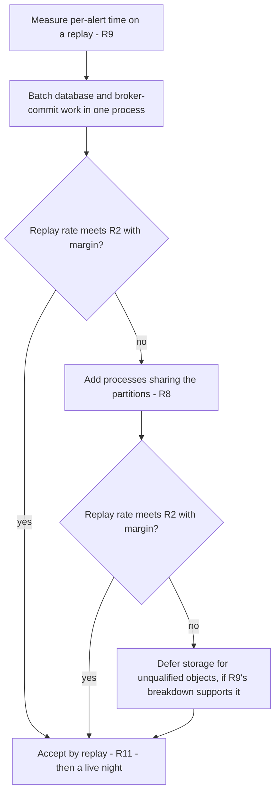
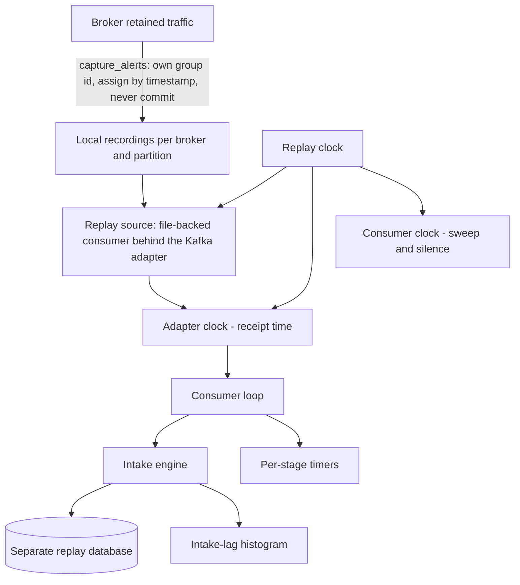
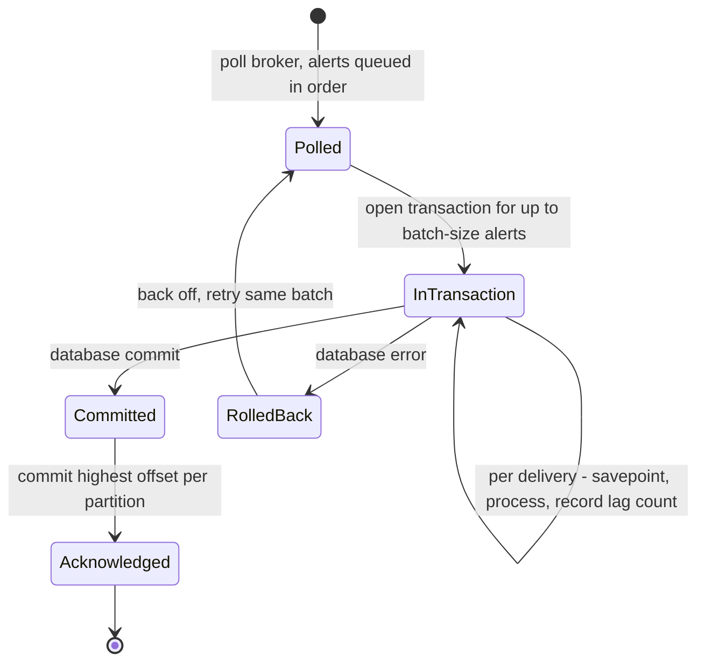
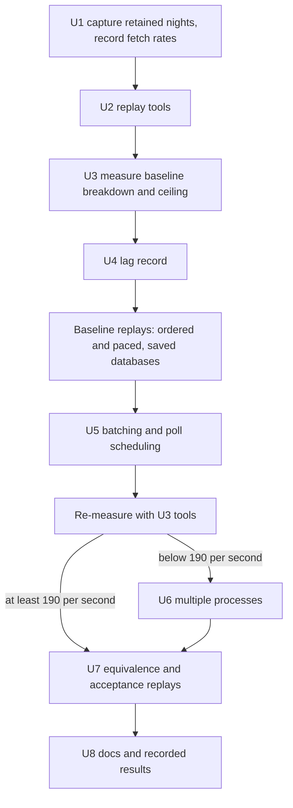

# Consumer Intake Throughput - Plan

## Goal Capsule

- **Objective:** On every Rubin night, including nights twice as busy as 2026-11-14, the service takes in and commits every broker's alerts within 10 minutes of publication, so its forecasts describe the current sky and forecasts triggered by Fink and Lasair meet the 10-minute latency target.
- **Means:** measure per-alert cost on a replay of locally captured broker traffic (KTD1, KTD2), batch per-alert database and broker-commit work in one process (KTD6), and add processes sharing the partitions only if the measurement after batching requires it (KTD8).
- **Product authority:**
  - `STRATEGY.md`: the Alert intake and filtering track, and the Serving and operations track.
  - This work builds on `docs/plans/2026-11-12-0629-feat-alert-intake-and-filtering-plan.md` and leaves that plan's forecast rules unchanged.
  - Not active scope: pruning stored light curves, the recreated-topic fix, closing suspected gaps at the next delivery, and a per-night option for the forecast-latency report.
- **Stop conditions:** Stop and report instead of building around it in either case:
  - the U3 measurement shows a per-alert cost that neither batching nor added processes can bring to R2's target, so R10's storage deferral would be needed (that path is not planned here);
  - the U7 equivalence replay shows a forecast difference that cannot be traced to a defect in this branch;
  - a broker's sustained fetch rate measured in U1 is below its rate required at R2's target. No intake change in this plan can fix a link.
- **Execution profile:**
  - **Delivery:** one pull request.
  - **Sequencing:** U1-U4 land first and fix the baseline. U5 follows. U6 is built only if U3's re-measurement after U5 falls below 190 alerts a second. U7 and U8 close the work.
  - **Who does it:** `ce-work` executes. Per the project `CLAUDE.md`, the branch is pushed to `bot` and the PR is opened on `scimma/seldon-service`. The deployment repository is not touched.
- **Open blockers:** none. Capturing traffic is a run-time step (U1), not a blocker; whichever nights are retained when it runs are used (see Dependencies / Assumptions).

---

## Product Contract

_Product Contract preservation: unchanged. Outstanding Questions deferred to planning are resolved in the Planning Contract._

### Summary

The consumer takes in alerts fast enough to stay within 10 minutes of every broker at a sustained 150 alerts a second, with forecast outputs unchanged.
The work starts by measuring where intake time goes on a replay of retained broker traffic.
It then batches per-alert work in one process, and adds processes sharing the partitions only if batching falls short.
A replay of retained nights at the target rate accepts it, and a busy live night confirms it.

### Problem Frame

**On a busy night the consumer reads alerts far more slowly than the brokers publish them.** On 2026-11-14:
- **Babamul's burst:** Babamul published 105,142 alerts in the hour from 00:00 UTC, about 72 a second over the busiest 10 minutes and about 110 a second in the busiest minute.
- **The consumer's ceiling:** the consumer took in a flat 32,000 to 33,000 Babamul alerts an hour, about 9 a second, for three hours.
- **The lag:** Babamul alerts reached it a median of 106 minutes after publication, and up to 185 minutes.

**The lag spread to the other brokers.** One process reads all brokers in turn, so Fink's alerts queued behind the backlog:
- **Fink-triggered forecasts:** their 90th percentile went from 2.0 minutes on 2026-11-13 to 12.3 minutes over both nights, with 85.3% within 10 minutes against the plan's 90%.
- **Replays:** 152 Babamul deliveries arrived more than 60 minutes after publication, so they count as replays and drop out of the latency figure.
- **Lasair:** it escaped only because its burst came in the first hour, before the backlog built up.

**Nothing was lost.** Coverage was 100% on both nights.

**The cost is timeliness.** A lagging consumer forecasts a sky that is hours old, exactly when the sky is busiest.

**Alert volume is growing:**
- Babamul's volume on 2026-11-14 (107,967 alerts) was more than twice that of 2026-11-13 (46,431).
- Rubin's alert volume is expected to grow as template coverage fills in.

**Forecasting is not the bottleneck.** The night's 6,433 forecasts at 0.1 to 0.45 seconds each are under an hour of compute.

**The cost is in taking in alerts, nearly all of which never lead to a forecast.** Babamul is the full stream, and it cannot be dropped:
- **Earliest delivery:** it delivered 6,429 of the 6,433 forecast detections and was usually the earliest delivery, so most forecasts use its light curve.
- **Forecasts only it made possible:** 211 forecasts were of detections no qualifying broker delivered.
- **The seven-day hold:** its alerts are kept for seven days in case their object qualifies later, although about 94% of its objects never do.

**Which part of intake costs the most has not been measured.**

Evidence: `docs/reports/2026-11-14-live-check-night-2026-11-13.md` and `docs/reports/2026-11-15-live-check-night-2026-11-14.md`.

### Key Decisions

- **Keep up with every broker, the full stream included.** A guarantee for the qualifying brokers alone would leave Babamul hours behind on a busy night. (session-settled: user-directed - chosen over guaranteeing only Fink and Lasair, and over staging that first: Babamul supplies most forecasts' light curves and some forecasts no qualifying broker delivers.) Governs R1.
- **The lag target is 10 minutes.** It matches the forecast latency target, so a forecast whose triggering delivery came from Babamul can meet it too. (session-settled: user-approved - chosen over 30 or 60 minutes, which would let Babamul-triggered forecasts miss 10 minutes during bursts.) Governs R1.
- **Size for twice the 2026-11-14 peak.** This covers the doubling already seen between two nights, without designing for volumes no one has measured. (session-settled: user-approved - chosen over the 2026-11-14 peak only, and over scaling on demand with no fixed figure.) Governs R2.
- **No fixed compute budget.** The deployment can supply what the target needs. (session-settled: user-directed - chosen over staying at one CPU, or capping intake at about four CPUs.) Governs R7.
- **Forecast outputs stay identical.** Only speed changes. (session-settled: user-approved - chosen over letting forecasts use the qualifying broker's light curve instead of Babamul's, and over dropping detections only Babamul delivered before their object qualified.) Governs R4, R5, R6.
- **Measure, then batch, then scale out.** Batching is the least added complexity likely to give a large gain, and more processes reach the margin if it falls short. Deferring storage for unqualified objects is held back. (session-settled: user-approved - chosen over scaling out only, deferring storage for unqualified objects first, or leaving the choice entirely to measurement.) Governs R9, R10.
- **Pruning stored light curves is separate work.** It is a storage outcome, not a throughput one. (session-settled: user-approved - chosen over folding it into this work.)
- **No separate priority for the qualifying brokers.** Keeping up with every broker already protects Fink and Lasair.
- **Lag is measured from broker publication to the consumer's commit, not by forecast latency.** The forecast-latency figure includes the known wait for qualification. Governs R3.

### Requirements

**Throughput and lag**

- R1. Throughout a Rubin night, including its bursts, the consumer commits each broker's alerts within 10 minutes of that broker publishing them.
- R2. R1 holds at a sustained rate of 150 alerts a second over 10 minutes across all brokers, and at about 225,000 alerts in one hour across all brokers (twice the roughly 112,000 all three carried in the hour from 00:00 UTC on 2026-11-14).
- R3. The service's own records show, per broker and per night, the lag from broker publication to the consumer's commit.

**Unchanged outputs**

- R4. Given the same deliveries in the same order of receipt, the service forecasts or refuses the same detections, from the same light curves, as it does today. Across several processes, order of receipt means the order in which deliveries are committed under the object's lock.
- R5. Each detection is still forecast at most once per checkpoint, and a broker message is still acknowledged only after everything it produced is committed. This holds when work is batched or spread across processes, and across crashes and restarts.
- R6. Coverage, skips, gaps, and object histories in `alert_report` keep their meaning and remain correct.

**Resources and operation**

- R7. Intake may use as many CPUs, processes, and Postgres resources as the target needs.
- R8. When more than one consumer process runs, the number of processes is set by configuration, not by a code change.

**Approach and evidence**

- R9. Before intake is changed, the time spent per alert is measured under the live CPU limit, on a replay of retained broker traffic. The measurement breaks the time down into network fetch, waiting in broker polls (including quiet brokers' poll timeouts), decoding, parsing, database writes, broker commits, and forecasting, and the breakdown is recorded with the plan.
- R10. The first change batches per-alert database and broker-commit work in one process. Processes sharing the partitions are added only if the measured rate after batching is below R2's target plus a 25% margin, about 190 alerts a second. Deferring storage for unqualified objects is used only if the measurement shows that batching and added processes cannot reach R2.

**Verification**

- R11. A replay of retained nights into a separate database, fed at no less than R2's rate, keeps every broker within R1's lag. Today's code and the changed code each replay the same retained traffic in the same order of receipt, each into a fresh database starting from the earliest retained night, and their forecasts match detection by detection, per R4. During a replay, lag is measured against a replay clock: each alert's recorded publication time, shifted to the replay's start and divided by its speed-up.
- R12. A replay never commits read positions for the live consumer groups and never writes to the live database.

The staged approach of R10 as a decision boundary:

### Acceptance Examples

- AE1. **Covers R1, R2, R11.**
  - **Given:** the busiest retained night (2026-11-14 while it is retained) replayed fast enough that its busiest 10 minutes run at 150 alerts a second.
  - **When:** the replay runs.
  - **Then:** every broker's alerts are committed within 10 minutes of their publication time on the replay clock, and the backlog never grows past that.
- AE2. **Covers R5.**
  - **Given:** the consumer stops partway through a batch, after the database has committed some work but before the broker has been acknowledged.
  - **When:** it restarts.
  - **Then:** the unacknowledged messages are redelivered, no detection gets a second forecast, and none is lost.
- AE3. **Covers R4, R5.**
  - **Given:** Babamul and Lasair deliveries of the same detection, handled at the same moment by two processes.
  - **When:** the detection is owed a forecast.
  - **Then:** it gets exactly one forecast, built from the light curve of the delivery committed first under the object's lock. With one process, that is the earlier-received delivery.
- AE4. **Covers R10.**
  - **Given:** batching measures 300 alerts a second on the replay.
  - **Then:** no processes are added.
  - **But:** if batching measures 60 a second, processes sharing the partitions are added and measured again.
- AE5. **Covers R11.**
  - **Given:** today's code and the changed code have each replayed the same retained traffic, in the same order of receipt, into fresh databases.
  - **When:** the two databases are compared.
  - **Then:** each detection has the same outcome (forecast or refused), and each forecast has the same light curve and grid.

### Success Criteria

- **Replay:** the acceptance replay of R11 passes at no less than 150 alerts a second sustained over 10 minutes.
- **Live night:** on the first live night whose Babamul volume is at least that of 2026-11-14:
  - every broker's maximum lag (R3) is under 10 minutes, with the 90th percentile reported as a diagnostic;
  - no delivery counts as a replay;
  - forecasts triggered by Fink and by Lasair are each 90% or more within 10 minutes.

### Scope Boundaries

- **Pruning:** deleting the stored light curves of objects still unqualified after the seven-day hold is separate work.
- **Other consumer follow-ups:** recovering when a recreated topic invalidates stored read positions, closing suspected gaps at the next delivery, and a per-night option for the forecast-latency report are all separate. R3's per-broker, per-night intake-lag record is in scope.
- **Forecast rules:** they are unchanged. This includes which detections are forecast, which delivery's light curve is used, the seven-day hold, and the qualification rule.
- **Broker priority:** separate priority for qualifying brokers is not built (see Key Decisions).
- **Deployment:** the production deployment repository is not touched.
- **The Dockerfile build-log token leak:** it is a separate follow-up.

### Dependencies / Assumptions

- **Replay data:**
  - Babamul retains about nine days of alerts, Fink about ten, and Lasair about seven.
  - Lasair holds no 2026-11-13 traffic, because its topic was recreated on 2026-11-14.
  - Lasair's 2026-11-14 traffic expires around 2026-11-21, and Babamul's 2026-11-13 and 2026-11-14 traffic around 2026-11-22.
  - The replay uses whichever nights are retained when the work starts.
  - Nothing has been copied yet.
- **Where the time goes is unmeasured.** That light-curve storage dominates per-alert cost is a hypothesis, not a measurement. R9 settles it.
- **Memory:** each consumer process loads the SELDON model, about 2 GB of memory each (`docs/solutions/ml-runtime/seldon-cpu-viability.md`).
- **Fink's network link may itself be a limit at twice the volume:**
  - The probe measured about 0.11 MB/s to Fink from the development host (`docs/solutions/broker-intake/lsst-broker-alert-fields.md`).
  - Twice the 2026-11-14 Fink burst, about 3,650 alerts an hour at 115 KB each, is about 0.12 MB/s.
  - A replay from local copies does not test this.
- **Babamul's network link is unmeasured at the target rate.** 150 alerts a second at about 18 KB each is about 2.7 MB/s, roughly 16 times what the consumer pulled on 2026-11-14. A replay from local copies does not test this either.
- **Parallelism:** Babamul's 36 partitions bound how many processes can share its stream in one consumer group.

### Outstanding Questions

**Resolve Before Planning:** none.

**Deferred to Planning:** none remain. Planning resolved them:
- replay mechanics in KTD1 and KTD2;
- the comparison in KTD3;
- process layout in KTD8;
- Fink and Babamul bandwidth in U1;
- lag reporting in KTD5.

Postgres tuning is left to implementation (see Planning Contract, Deferred to Implementation).

### Sources / Research

- **Grounding notes on the consumer loop, the intake engine, Kafka acknowledgement, and the compose service:** `docs/grounding/consumer-intake-throughput.md`.
- **The live-check reports:** `docs/reports/2026-11-14-live-check-night-2026-11-13.md` and `docs/reports/2026-11-15-live-check-night-2026-11-14.md`.
- **The measured cost breakdown (U3):** `docs/reports/2026-11-15-intake-cost-breakdown.md`.
- **The equivalence and acceptance results (U7):** `docs/reports/2026-11-15-intake-throughput-acceptance.md`.
- **The plan whose forecast rules this work preserves:** `docs/plans/2026-11-12-0629-feat-alert-intake-and-filtering-plan.md`.
- **Broker volumes, fetch limits, and forecast cost:** `docs/solutions/broker-intake/lsst-broker-alert-fields.md`.
- **Code:**
  - the consumer loop, in `app/seldon/management/commands/consume_alerts.py`;
  - the intake engine, in `app/seldon/intake/engine.py`;
  - the Kafka adapter, in `app/seldon/infrastructure/brokers/kafka.py`.

---

## Planning Contract

### Key Technical Decisions

- KTD1. **Replay from a local byte copy of broker traffic, fed through the real adapter.**
  - **Capture:** a capture command reads each broker's retained messages for a chosen window under its own group id. It uses explicit partition assignment from timestamp offsets and never commits, so the live consumer groups are untouched (R12). It writes each message's topic, partition, offset, timestamp, key and value to local files.
  - **Replay:** replay injects a file-backed consumer through the Kafka adapter's existing consumer seam (`app/seldon/infrastructure/brokers/kafka.py`, the `consumer=` constructor argument). Decoding, parsing, receipt and acknowledgement run unchanged.
  - **Why:** the decoded fixtures in `app/seldon/tests/fixtures/broker_alerts/` hold no raw bytes. A distinct live group would also re-read over the network on every run, and nothing would keep it in step with the copy.
  - **Network fetch:** network fetch is the one stage a local replay cannot show. The capture command records its own sustained fetch rate per broker, which supplies that figure (R9).
- KTD2. **A replay clock drives every time the intake reads.**
  - **The clock:** each message's replay publication time is its recorded publication time, shifted to the replay's start and divided by the speed-up.
  - **What it controls:** a message is released when the replay clock reaches that time. The adapter clock and the consumer clock are both bound to the replay clock, which fixes receipt times, sweep timing and silence checks.
  - **Lag:** lag during a replay is measured against replay publication times (R11).
  - **Modes:** a paced replay runs at a chosen speed-up. A maximum-rate replay releases everything immediately, to find the ceiling. Ordered mode (KTD3) uses the clock as KTD3 defines.
  - **Quiet brokers:** the file-backed consumer's `consume(timeout)` blocks, in wall time, for up to the timeout when nothing is due, as librdkafka does. The baseline then shows today's quiet-broker poll waits.
- KTD3. **Forecast equivalence uses an ordered mode, separate from the throughput runs.**
  - **Ordered mode:** messages are released in global publication order, as runs of consecutive messages from one broker. The next run is released only after the previous run is fully acknowledged. Ties are broken by broker, partition and offset.
  - **Run size:** a run is capped at the baseline's 100 messages a poll, so each run is one poll and one cycle in both codes.
  - **The clock in ordered mode:** it is held at the run's first message's recorded publication time, shifted to the replay start but not sped up. It advances only when the next run is released.
  - **Sweep:** the sweep is evaluated only at run boundaries, before the next run is released.
  - **Why it gives identical outcomes:** today's code takes such a run one alert at a time, and batched code takes it as one batch. Both commit deliveries in the same order with the same receipt times, so R4's precondition holds and the outcomes must be identical.
  - **The comparison:** it covers each detection's outcome (forecast or refused), source light curve, grid, outputs and the object's qualifying event. It excludes `stored_at`, `app_version` and row ids, which differ by design.
  - **Throughput runs:** they check lag (R1, R2) and the invariants (exactly one forecast per detection and checkpoint, nothing left owed), not identity.
  - **Why it is separate:** at full speed, cross-broker processing order depends on scheduling, so identity is not a fair test there.
- KTD4. **The baseline is this branch after U1-U4, before batching.**
  - Current `main` has no replay tools. U1-U4 change no forecast behavior: they add capture, replay, timing and the lag record.
  - So the commit after U4 is today's code for R11, and it is replayed into its own database before U5 lands.
- KTD5. **The intake-lag record is a per-broker, per-night histogram at one-second resolution, reported by a new `alert_report intake-lag` subcommand.**
  - **Why not the existing rows:** `Delivery` rows cannot serve: `sweep_pending` deletes about 94% of Babamul's after seven days, and `received_at` is stamped at poll, not at commit.
  - **What a row is:** each committed alert adds one count to a row of (broker, publication night, lag in whole seconds). Lag is from publication to the moment its batch is committed. Lags past one hour share an overflow bucket.
  - **Alerts without a publication time:** an alert with no publication time is counted under its receipt night in a separate unknown-publication bucket, which the report shows as a count.
  - **Counted once:** an alert is counted only when its work is newly stored, meaning a new delivery or a new intake skip. A redelivered alert whose work was already committed adds no second count.
  - **Write shape:** counts are accumulated in memory for the batch, then applied once at the end of the batch transaction. The upserts go one per distinct key, in sorted key order, so a rollback also drops them and replicas cannot deadlock on them.
  - **What it gives:** exact counts, a maximum to one second, and percentiles. The table grows by at most about 3,600 rows per broker per night.
  - **The report:** it gives each broker's maximum, 90th percentile and median per night, plus the share within 10 minutes.
  - **Which night:** nights are grouped by publication night (the 12:00 to 12:00 UTC dayObs), as the help text will state.
- KTD6. **Batch in one process.**
  - **Unit of work:** one batch is up to `SELDON_INTAKE_BATCH_SIZE` consecutive polled alerts from one broker, in poll order.
  - **Transaction:** the whole batch is one database transaction, with a savepoint per delivery. A value that cannot be stored still becomes an acknowledged intake skip without aborting the batch.
  - **Broker commit:** after the transaction commits, the consumer commits each partition once, synchronously, at the highest acknowledged offset plus one. It keeps that message's publication-time metadata, which the gap detection reads back.
  - **Failure:** a database failure rolls back the whole batch and leaves it queued for retry under the existing backoff. Nothing is acknowledged, so a crash causes redelivery, never a duplicate (R5).
  - **The broker's own contract:** this matches the adapter rule that acknowledging one alert covers every earlier alert from the same partition (`app/seldon/infrastructure/brokers/base.py`).
- KTD7. **Stop waiting on quiet brokers.**
  - **Today:** each cycle polls every broker with a one-second timeout and takes at most 100 messages. Two quiet brokers can add two seconds of waiting per 100 Babamul alerts, a ceiling near 50 alerts a second.
  - **The change:** each broker is polled with a zero timeout. Only when a whole cycle returned no alerts from any broker does the loop block once, for the poll timeout, before the next cycle.
  - This ships with KTD6 whatever U3 shows, because it is per-alert overhead in one process (R10).
- KTD8. **If needed, add processes as replicas in the same consumer groups.**
  - **Layout:** every process reads all three brokers in shared groups, and Kafka spreads the partitions among them.
  - **Housekeeping:** one process at a time holds a Postgres advisory lock and runs the sweep and the silence check.
  - **Shared last-commit record:** a small table holds (broker, consumer instance, last committed at). Each batch updates its own row inside its transaction. The lock holder's silence check takes each broker's latest value across instances, so a process holding no partitions of a broker cannot record a false gap (R6).
  - **Deadlocks:** a Postgres deadlock or serialization failure retries the batch at once. It is logged, and it does not escalate the outage backoff.
  - **Rebalances:** a commit refused because a partition was revoked is logged as a rebalance, and the batch is left to redelivery instead of crashing the process.
  - **Concurrent inserts:** creating an object, detection or light-curve point that another process has just created retries the delivery instead of failing.
  - **Why not separate processes per role:** splitting the full stream from the qualifying brokers would add a second layout to configure and test, and keeping up with every broker already protects Fink and Lasair.
  - Built only under R10's condition. Its knobs are R8's process count and the compose replica setting.

### Assumptions

- **Equivalence evidence:** ordered-mode equivalence on retained traffic, plus the throughput runs' invariants, is accepted as R11's evidence that outputs are unchanged. Multi-process identity is shown by U6's concurrency tests, not by replay.
- **Forecast determinism:** forecasts are deterministic for identical input on the same image and thread count, so outputs can be compared exactly. If U7 shows floating-point differences only, outputs are compared to a stated tolerance, and the light curve and grid exactly.
- **Replay data:** whichever nights are retained when U1 runs are used. The busiest retained night stands in for AE1.

### Deferred to Implementation

- **Batch size and poll timeout defaults:** chosen from U3's measurement.
- **Measurement-driven reductions:** schema caching in the Babamul and Fink parsers, prefetching objects and detections per batch, and fewer per-delivery queries are done only where U3's breakdown shows they matter.
- **Postgres tuning:** for example connection count, `synchronous_commit` or a CPU limit for `db`. Done only if replay shows Postgres is the next limit.
- **Recording format:** the exact format of the recordings, for example compressed JSON lines or one file per partition.
- **Replica startup:** how replicas avoid running migrations at once at startup. Settle this if U6 is built.

### High-Level Technical Design

How a recorded message reaches the database in each mode:

Batch lifecycle in one process (KTD6):

Measurement and decision sequence (R9, R10):

---

## Implementation Units

### U1. Capture retained broker traffic to local recordings

- **Goal:** Copy every enabled broker's retained messages for a chosen time window to local files without touching the live consumer groups, and report each broker's sustained fetch rate.
- **Requirements:** R9 (network fetch figure), R11, R12. Dependencies / Assumptions: replay data, Fink and Babamul links.
- **Dependencies:** none.
- **Files:**
  - create `app/seldon/management/commands/capture_alerts.py`;
  - create `app/seldon/replay/recording.py` (the recording reader and writer);
  - create `app/seldon/tests/test_capture_alerts.py`;
  - modify `app/seldon/infrastructure/brokers/kafka.py`, only if a config-building helper must be shared.
- **Approach:**
  1. Build each broker's Kafka configuration from `kafka_config()` with a distinct group id. Babamul's must still start with `<username>-`.
  2. Turn off automatic commits. Assign partitions explicitly from timestamp offsets for the window start, then read to the window end or the high watermark.
  3. Write messages per broker and partition with topic, partition, offset, timestamp, key and value. Skip none.
  4. Log counts, bytes, elapsed time and MB/s per broker. Record each broker's sustained rate beside its rate required at R2's target in the U3 report: Babamul about 2.7 MB/s, Fink about 0.12 MB/s, and Lasair from twice its 2026-11-14 burst.
  5. Refuse to run if the configured output already holds a recording for the same window, unless told to replace it.
  6. Credentials never appear in logs or file names.
- **Patterns to follow:** `FakeConsumer` in `app/seldon/tests/test_broker_adapters.py`; command and option style in `app/seldon/management/commands/consume_alerts.py`; the credential-sentinel assertions in the adapter tests.
- **Test scenarios:**
  - A fake consumer holding messages on two partitions, before, inside and after the window: only in-window messages are written, with exact bytes, key and timestamp.
  - The capture never calls `commit` on the consumer.
  - The capture never subscribes with the live group id.
  - A Babamul group id is prefixed with the username.
  - Credential sentinel values appear in no log line and no output path.
  - A second capture of the same window without the replace option stops with a clear message and leaves the first recording intact.
  - An empty partition yields an empty recording entry, not an error.
- **Verification:** a capture of a short live window reads back byte for byte through the recording reader, and the live groups' committed offsets are unchanged before and after.

### U2. Replay recordings through the real adapter into a separate database

- **Goal:** Feed recordings through the Kafka adapter and consumer loop under a replay clock, in paced, maximum-rate and ordered modes, writing only to a separate database.
- **Requirements:** R11, R12; KTD1, KTD2, KTD3.
- **Dependencies:** U1.
- **Files:**
  - create `app/seldon/replay/source.py` (the file-backed consumer and replay clock);
  - create `app/seldon/management/commands/replay_alerts.py`;
  - create `app/seldon/tests/test_replay.py`;
  - modify `app/seldon/management/commands/consume_alerts.py` to let the replay command inject adapters and clocks into `IntakeConsumer`, following its existing `clock` and `sleep` seams.
- **Approach:**
  1. **The file-backed consumer:** it implements the methods the adapter calls (`subscribe`, `committed`, `get_watermark_offsets`, `consume`, `commit`, `close`). It releases messages by replay publication time (KTD2), or in KTD3's ordered runs, and records commits in memory only.
  2. **Exiting:** the replay command builds adapters with this consumer and binds the adapter and consumer clocks to the replay clock. It exits when every recording is drained and acknowledged.
  3. **Database guard:** it never opens a broker connection. The command takes a `--database` name, and before any query it:
     - refuses a name equal to the configured `DATABASES['default']['NAME']`;
     - creates that database on the same server, refusing if it exists unless told to replace it;
     - migrates it, then switches the default connection to it.
  4. **Ending a run:** it prints a summary of alerts, elapsed wall time and alerts a second.
- **Patterns to follow:** `FakeAdapter` and `FakeClock` in `app/seldon/tests/test_consume_alerts.py`; the `build_adapters` patch point.
- **Test scenarios:**
  - **Paced mode:** a recording of three Babamul messages one second apart, replayed at 2x, releases them 0.5 replay-seconds apart, and each delivery's `received_at` equals its replay release time.
  - **Ordered mode:** Fink, Babamul, Babamul, Lasair messages in publication order release as three runs. The second run is held until the first is acknowledged.
  - **Ties:** equal publication times are ordered by broker, partition and offset.
  - **Commit isolation:** commits from the adapter are recorded in memory, and no network client is created.
  - **Live-database guard:** running against the configured database name stops before reading any recording.
  - **Existing database:** an existing replay database is refused without the replace option.
  - **Ordered-mode clock:** a run of 100 Babamul messages gives every delivery the run's held clock time. A sweep boundary falling inside the run fires only after the run is acknowledged.
  - **Quiet brokers:** in a maximum-rate replay with two empty broker recordings, each empty broker's poll blocks for the poll timeout.
  - **Clocks:** the sweep runs on replay time. A replay spanning eight replay-days runs the seven-day sweep.
  - **Integration:** a short recording built from the existing Fink, Lasair and Babamul fixtures, re-encoded to bytes, produces the same detections and forecasts as feeding those fixtures to `process_delivery` directly.
- **Verification:** a replay of a captured night into a fresh database completes, and its delivery counts per broker equal the recording's message counts, less any skips.

### U3. Per-stage timing and the recorded cost breakdown

- **Goal:** Measure where an alert's intake time goes under the live CPU limit, and record the breakdown and ceiling before any intake change.
- **Requirements:** R9, R10.
- **Dependencies:** U2.
- **Files:**
  - create `app/seldon/intake/timing.py` (stage timers and summary);
  - modify `app/seldon/management/commands/consume_alerts.py` and `app/seldon/infrastructure/brokers/kafka.py` to time stages;
  - create `app/seldon/tests/test_intake_timing.py`;
  - create `docs/reports/2026-11-NN-intake-cost-breakdown.md`, dated when run.
- **Approach:**
  1. **Stages:** accumulate wall time for poll wait, decode, parse, engine database work, forecasting and broker commit. Network fetch comes from U1's capture rates.
  2. **Output:** log a per-stage summary at a configurable interval, and at the end of a replay.
  3. **Cost:** timing is always on and cheap, a monotonic clock read per stage.
  4. **Recording:** run a maximum-rate replay of the busiest retained night under `cpus: 1` and record the breakdown and ceiling in the report, linked from this plan's Sources. Re-run it after U5, and after U6 if built.
- **Patterns to follow:** injectable clock pattern in `IntakeConsumer`; logging through `logging`, never `print`.
- **Test scenarios:**
  - With an injected clock that advances fixed amounts per stage, the summary reports each stage's total and its share of the elapsed time.
  - Each delivery's forecast time is counted under forecasting, not under engine database work.
  - A broker commit is timed once per commit call, not per alert.
  - The summary is emitted at the configured interval and once at shutdown.
- **Verification:** the breakdown report exists, its stage shares sum to within a few percent of total elapsed time, and it states the measured baseline rate.

### U4. Intake-lag record and the `alert_report intake-lag` subcommand

- **Goal:** Record and report each broker's per-night lag from publication to commit, in a form that survives the seven-day sweep.
- **Requirements:** R3, R6; KTD5. This also supplies the Success Criteria's live-night figures.
- **Dependencies:** none. It lands before the baseline replay so both runs record lag.
- **Files:**
  - modify `app/seldon/models.py` (a new lag-histogram model);
  - create `app/seldon/migrations/0002_intake_lag.py`;
  - modify `app/seldon/intake/engine.py` or `app/seldon/management/commands/consume_alerts.py` at the point where an alert's work commits;
  - modify `app/seldon/infrastructure/brokers/base.py` and `app/seldon/infrastructure/brokers/kafka.py` to carry a publication time on every polled item, skips included;
  - modify `app/seldon/management/commands/alert_report.py`;
  - modify `app/seldon/tests/test_alert_report.py` and `app/seldon/tests/test_models.py`;
  - create `app/seldon/tests/test_intake_lag.py`.
- **Approach:**
  1. **Recording:** count every newly stored alert, whether forecast, refused, pending or skipped, inside the same transaction as its work, per KTD5's write shape. A rollback then also rolls back its count.
  2. **Clock:** the commit time is taken from the consumer clock just before commit, so replays use the replay clock.
  3. **Report:** the report builder and renderer follow the existing `builders` table and `--json` convention.
- **Patterns to follow:** `latency` and `gaps` subcommands and `percentile_value` in `app/seldon/management/commands/alert_report.py`; `setUpTestData` builders and the `ReadOnlyTests` invocation list in `app/seldon/tests/test_alert_report.py`.
- **Test scenarios:**
  - Three alerts from one broker, published at 23:59 UTC with lags of 4, 4 and 70 seconds, produce counts 2 and 1 under that night.
  - The report gives a maximum of 70 s, and 100% within 10 minutes.
  - An alert published at 12:00:00 UTC is counted under the new night.
  - A lag of 2 hours lands in the overflow bucket. The report then states the maximum as more than one hour.
  - A batch that rolls back leaves no counts behind.
  - An intake skip is counted under its publication night.
  - An alert with no publication time is counted in the unknown-publication bucket.
  - A redelivery of an alert whose work is already stored adds no count.
  - After `sweep_pending` discards an unqualified object's deliveries, the lag counts are unchanged.
  - `intake-lag --json` returns the same figures as the text output.
  - The subcommand leaves the database fingerprint unchanged (added to `ReadOnlyTests`).
- **Verification:** a replay of a captured night yields per-broker lag rows whose totals equal the alerts each broker delivered.

### U5. Batch intake and non-blocking polls in one process

- **Goal:** Raise one process's intake rate by batching database and broker-commit work and by not waiting on quiet brokers, with outputs unchanged.
- **Requirements:** R1, R2, R4, R5, R6, R10; KTD6, KTD7. Covers AE2.
- **Dependencies:** U3 baseline measurement, and baseline replays saved per KTD4.
- **Files:**
  - modify `app/seldon/management/commands/consume_alerts.py` (batching, poll scheduling, new options);
  - modify `app/seldon/intake/engine.py` (a batch entry point with a savepoint per delivery);
  - modify `app/seldon/infrastructure/brokers/kafka.py` (per-partition batched commit);
  - modify `app/seldon/infrastructure/brokers/base.py` (adapter contract for a batched acknowledgement);
  - modify `app/seldon/config/intake.py` and `env/.env.default` (`SELDON_INTAKE_BATCH_SIZE`, poll timeout);
  - modify `app/seldon/tests/test_consume_alerts.py`, `app/seldon/tests/test_intake_engine.py`, `app/seldon/tests/test_broker_adapters.py` and `app/seldon/tests/test_intake_settings.py`.
- **Approach:**
  1. **Batching:** drain a broker's queue in batches per KTD6, keeping poll order.
  2. **Acknowledgement:** after commit, the adapter acknowledges the batch with one commit per partition.
  3. **Polling:** poll scheduling follows KTD7.
  4. **Measurement-driven reductions:** apply the reductions under Deferred to Implementation that U3 shows matter, each re-measured.
  5. **Shutdown:** SIGTERM finishes the batch in hand.
- **Execution note:** Start with a failing consumer test showing that a two-alert batch makes one broker commit, at the second alert's offset, only after both alerts' work is stored.
- **Patterns to follow:** `FakeAdapter` `on_ack` and `stored_at_ack` checks; `connection.execute_wrapper(fail_queries)` outage injection in `app/seldon/tests/test_consume_alerts.py`; `MultiRecordMessageTests` in the adapter tests.
- **Test scenarios:**
  - **One commit per partition:** a batch of five alerts from two partitions makes one commit per partition at each partition's highest offset plus one, carrying that message's timestamp metadata.
  - **Ordering:** the commit happens only after all five alerts' work is stored.
  - **Covers AE2:** a database outage injected at the fourth alert rolls back the whole batch with no commit, and on recovery all five are processed once, with exactly one forecast per owed detection.
  - **Skip inside a batch:** a value too large to store in the third alert becomes an acknowledged intake skip, while alerts one, two, four and five are stored.
  - **Multi-record messages:** a Babamul multi-record message split across two batches is committed only after its last alert, as today.
  - **Quiet brokers:** with two brokers empty and one holding 300 alerts, every broker is polled with a zero timeout, and no cycle blocks while any poll returned alerts.
  - **Idle:** after a cycle in which no broker returned alerts, the loop blocks once for the poll timeout.
  - **Settings:** `SELDON_INTAKE_BATCH_SIZE` defaults, an empty value means the default, and a non-positive value is rejected.
  - **SIGTERM:** a signal mid-batch stops after that batch's commit and acknowledgement.
- **Verification:**
  - the existing consumer, engine and adapter suites pass unchanged;
  - U3's re-measurement after U5 is recorded in the breakdown report;
  - the ordered replay of U5 matches the baseline per U7.

### U6. Several consumer processes (built only if U3 after U5 measures below 190 alerts a second)

- **Goal:** Run several consumer processes over shared partitions with outputs, exactly-once storage and gap records unchanged.
- **Requirements:** R4, R5, R6, R7, R8; KTD8. Covers AE3.
- **Dependencies:** U5 and its re-measurement.
- **Files:**
  - modify `app/seldon/management/commands/consume_alerts.py` (housekeeping lock, rebalance-safe acknowledgement);
  - modify `app/seldon/intake/engine.py` (retry on concurrent inserts);
  - modify `app/seldon/models.py` and create a migration (the shared last-commit record);
  - modify `app/seldon/infrastructure/brokers/kafka.py` (revoked-partition commit handling);
  - modify `docker/docker-compose.yml`, `docker/docker-compose.dev.yaml` and `env/.env.default` (process count);
  - possibly modify `app/entrypoints/docker-entrypoint.consumer.sh` (migrations at startup);
  - create `app/seldon/tests/test_intake_concurrency.py`.
- **Approach:**
  1. Implement KTD8's housekeeping lock, rebalance handling and concurrent-insert retry.
  2. Wire the process count to compose replicas.
  3. Each replica keeps `cpus` equal to `SELDON_TORCH_THREADS`, per `docs/solutions/ml-runtime/seldon-cpu-viability.md`.
- **Execution note:** The concurrency tests are the suite's first `TransactionTestCase`. Write them first, since `TestCase` cannot show lock contention.
- **Patterns to follow:** engine test helpers in `app/seldon/tests/test_intake_engine.py`; `select_for_update` on the object in `app/seldon/intake/engine.py`.
- **Test scenarios:**
  - **Covers AE3:** two threads with separate connections deliver Babamul's and Lasair's deliveries of the same detection at once. Exactly one forecast exists, built from the delivery committed first under the object's lock.
  - Two threads creating the same new object and detection at once both finish, with one object and one detection stored.
  - Two threads storing the same light-curve point at once both finish, with one point stored.
  - With two consumers, only the lock holder runs the sweep and the silence check.
  - A lock holder with no Babamul partitions reads another instance's recent Babamul commit and records no Babamul gap.
  - Two batches that lock the same two objects in opposite orders both finish, one after an automatic retry, with exactly one forecast per owed detection.
  - A commit refused for a revoked partition leaves the batch unacknowledged and the process running.
- **Verification:** a maximum-rate replay with the chosen process count meets R2 plus the 25% margin, with no duplicate forecasts and nothing left owed.

### U7. Equivalence and acceptance replays

- **Goal:** Show that the changed code produces identical forecasts to the baseline, and that it keeps every broker within 10 minutes at 150 alerts a second.
- **Requirements:** R1, R2, R4, R11, R12. Covers AE1, AE5.
- **Dependencies:** U5, and U6 if built.
- **Files:**
  - create `app/seldon/management/commands/compare_replays.py`;
  - create `app/seldon/tests/test_compare_replays.py`;
  - modify the U3 report, or create `docs/reports/2026-11-NN-intake-throughput-acceptance.md`.
- **Approach:**
  1. **Comparison command:** it takes two database names, registers two read-only connection aliases at runtime from the configured host and credentials, and compares per KTD3. It prints matched counts and every difference with its detection id, and exits non-zero on any difference.
  2. **Equivalence run:** replay the retained nights in ordered mode with the baseline (KTD4) and with the changed code, each into a fresh database, then compare.
  3. **Acceptance run:** replay the busiest retained night paced so its busiest 10 minutes run at 150 alerts a second. Read the lag histogram for that run and check the invariants.
  4. **Recording:** record both results.
- **Patterns to follow:** read-only discipline of `alert_report` (the database fingerprint check).
- **Test scenarios:**
  - Two databases with identical forecasts but different `stored_at`, `app_version` and row ids compare as equal.
  - A forecast whose light curve differs by one point is reported with its detection id.
  - A detection forecast in one database and refused in the other is reported.
  - A detection present in only one database is reported.
  - The command writes nothing to either database.
- **Verification:**
  - the equivalence comparison reports zero differences;
  - the paced 150-a-second replay shows every broker's maximum lag under 10 minutes on the replay clock, with no forecast duplicated and none left owed;
  - both results are recorded.

### U8. Documentation

- **Goal:** Document capture, replay, the new knobs, the lag report and the measured figures, so an operator can run and check intake.
- **Requirements:** R3, R8, R9.
- **Dependencies:** U1-U7.
- **Files:**
  - modify `docs/guides/running-the-alert-consumer.md`;
  - modify `docs/solutions/broker-intake/lsst-broker-alert-fields.md`, correcting the throughput and storage figures with measured ones;
  - modify `README.md`, only if a new command needs a pointer;
  - modify `env/.env.default` comments.
- **Approach:**
  1. **The guide:** add a capture-and-replay section, the batch size and process-count settings, and the `intake-lag` report.
  2. **The solution doc:** update its forecast-rate and capacity sections with the U3 and U7 figures.
- **Test expectation:** none, since this is documentation only.
- **Verification:** the guide's commands match the commands' actual options, and no credential or broker endpoint appears.

---

## Verification Contract

| Gate | Command or check | Applies to |
|---|---|---|
| Test suite | Run inside the compose stack with a private test database name: `docker compose --file docker/docker-compose.yml --file docker/docker-compose.dev.yaml --env-file env/.env.default --env-file env/.env.dev --profile slim_dev run --rm --no-deps -e DATABASE_TEST_NAME=<unique> app bash -c 'python manage.py test seldon.tests -v 1'` | every unit |
| Formatter | `black app/` | every unit with Python |
| Image builds | Only with output discarded (`--progress quiet`, redirected to `/dev/null`), never with logs read, because the build prints the GitHub token | any rebuild |
| Measurement | U3 breakdown report with baseline and post-change rates under `cpus: 1` | U3, U5, U6 |
| Equivalence | `compare_replays` between the baseline and changed-code ordered replays reports zero differences | U7 (R11, AE5) |
| Throughput | Paced replay at 150 alerts a second in the busiest 10 minutes: every broker's maximum lag under 10 minutes on the replay clock, with invariants held | U7 (R1, R2, AE1) |
| Isolation | Live consumer groups' committed offsets unchanged by capture and replay, and replays refuse the live database name | U1, U2 (R12) |
| Live confirmation | After merge and deployment, the first live night at least as busy as 2026-11-14 meets the Success Criteria, from `alert_report intake-lag` and `alert_report latency` | post-merge |

---

## Definition of Done

- U1-U5, U7 and U8 are complete. U6 is complete, or U3's post-U5 measurement at or above 190 alerts a second is recorded as the reason it was not built.
- Every unit's test scenarios exist and pass, and the full suite passes.
- `black app/` leaves no changes.
- The cost-breakdown and acceptance results are recorded under `docs/reports/` and linked from Sources.
- The equivalence comparison shows zero differences, and the paced acceptance replay meets R1 at R2's rate.
- No recording, replay database or captured traffic is committed to the repository.
- No credential or broker endpoint appears in code, logs, docs or reports.
- Experimental code from abandoned approaches is removed from the diff.
- The Success Criteria's live-night check is left as a post-merge step and named in the PR description.

---

## Deferred / Open Questions

These entries are review items left for the author. They do not block implementation.

### From 2026-11-15 review

- **Running out of throughput options would leave work with no defined end** - Goal Capsule stop conditions, compared with R10 (storage deferral as the last resort) (P1, coherence, confidence 100)

  If batching and added processes both fall short, the plan says to stop and report, while R10 says storage deferral is used in that case. No unit builds deferral.
  Change: keep stop-and-report, and state that R10's deferral would be planned as follow-up work rather than built in this PR.

- **The multi-process measurement cannot run on today's replay design** - U2 (replay recordings) and U6 (several consumer processes) (P1, whole-doc cross-model reviewer, confidence 75)

  Several replay processes would each replay every recording independently, because the file-backed consumer keeps its commits in each process's memory. So U6's throughput measurement would not exercise shared partitions.
  Change: for multi-process replays, assign each recorded partition to exactly one replay process, by process index, so the processes split the traffic as Kafka would.

- **A burst-only acceptance replay leaves the hourly target untested** - U7 (acceptance replays) (P1, whole-doc cross-model reviewer, confidence 75)

  A consumer could keep within 10 minutes over the busiest 10 minutes and still fall behind across the busiest hour.
  Change: the paced acceptance replay covers the whole busiest hour of the night, at least 225,000 alerts across brokers, with every broker's lag under 10 minutes throughout.

- **Speeding up a replay also shortens the seven-day hold** - KTD2 (replay clock) (P1, whole-doc cross-model reviewer, confidence 75)

  In paced and maximum-rate runs, receipt and sweep times follow the sped-up clock. Holds then expire earlier relative to later deliveries than they did live.
  Change: separate a pacing clock, which releases messages and measures lag, from a business clock, which follows the original recorded intervals and sets receipt and sweep times.
