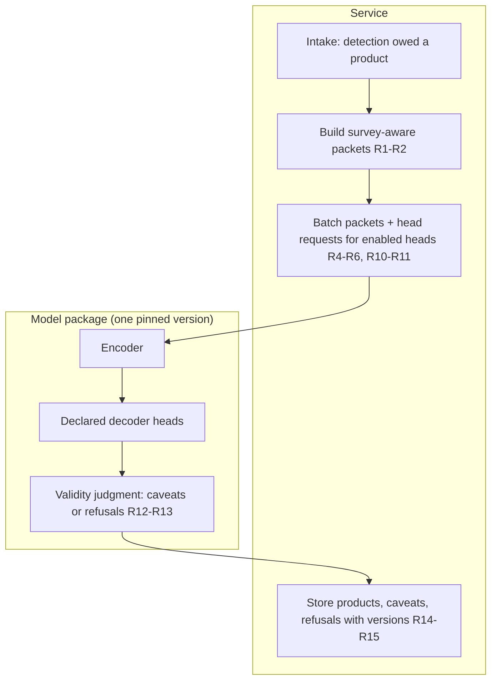
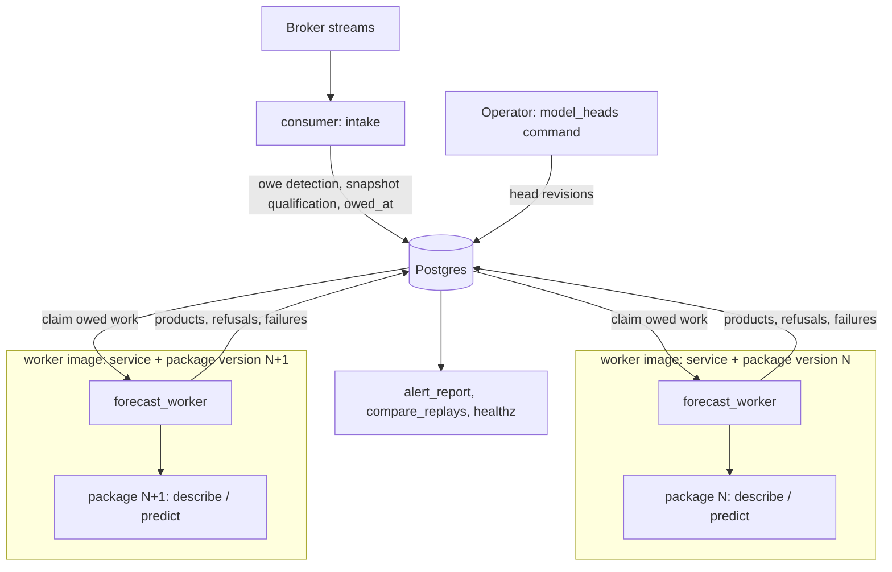
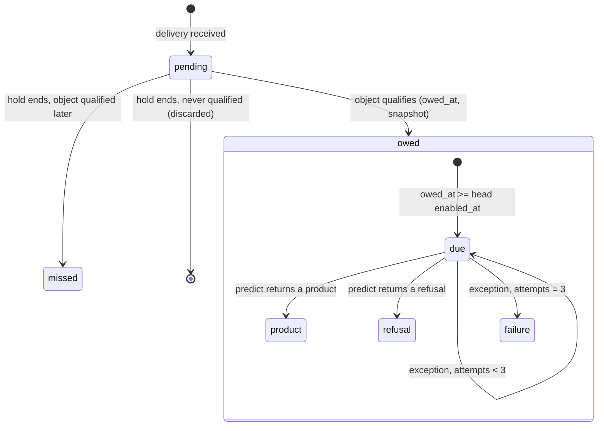

# Model Integration Contract - Plan

## Goal Capsule

- **Objective:** A new SELDON release, and later a model from another team, reaches live alerts by meeting a written contract and being deployed beside the previous version, with no new service code for its encoding or its decoder heads.
- **Means:** a versioned product-request contract between the service and a model package (R4), today's checkpoint moved behind it as a reference implementation (R18), and a specification, conformance kit, and model-developer guide that let the SELDON team implement it for their next release (R20-R22).
- **Product authority:**
  - `STRATEGY.md`: the Model integration track ("The contract a model plugs into, pinned versions, versions running side by side, and provenance on every output") and the boundary that every model is used at a pinned release.
  - Jack O'Brien's three-part interface proposal (Data, Encoding, Decoder Heads), adopted with the change recorded in the Key Decisions.
  - Not active scope: acquiring non-Rubin photometry from live streams, publication formats on Hopskotch, REST, and MCP, and the TEMPI world model's population-level, multi-modal, and online-learning features.
- **Open blockers:** none. The SELDON team's agreement to the contract shape is a dependency for the next release, not for the reference implementation.
- **Execution profile:** Deep. Ships as three pull requests from `bot` branches to `scimma/seldon-service`, grouped under Implementation Units: the contract package, the reference package, then the service cutover.
- **Stop conditions:** stop and ask before changing any Product Contract requirement, before any destructive data step beyond the migration KTD8 describes, and when the reference package cannot reproduce the reference outputs within tolerance (R18).
- **Who finishes:** an implementing agent builds each PR and opens it per the project CLAUDE.md shipping flow; the maintainer reviews and merges each one.
- **Product Contract preservation:** unchanged, except that the Deferred to Planning questions answered by the Planning Contract (KTD1-KTD12) were removed in place. The on-demand heads question stays open under Deferred to Planning.

---

## Product Contract

### Summary

The service and each model package meet at one versioned contract. The service sends a batch of survey-aware data packets and names the products it wants. The package encodes and decodes internally and returns, per object and per head, a product with its caveats or a refusal with a reason. Packages declare their heads, operators enable heads for live alerts, and today's SELDON checkpoint becomes the first implementation of the contract.

### Problem Frame

The service serves one SELDON checkpoint through SELDON-specific code in this repo: `app/seldon/infrastructure/ml/loader.py` loads it through `seldon_core`, and `encoding.py` and `forecast.py` turn an `ObjectRequest` into tensors and make one fused forward call that returns flux, class probabilities, and the latent together. There is no model abstraction, and `Forecast.checkpoint` is a plain string.

That shape cannot absorb what is coming. Jack reports that the next SELDON release takes photometry from surveys other than Rubin, including ZTF, and covers TDEs and AGN as well as supernovae. The TEMPI proposal (SkAI, Liu, Miller, Samia & Narayan) goes further: multi-modal inputs from many surveys in one latent space, decoder tasks chained so that energy depends on classification, which depends on redshift, latent sampling for multiple futures, population-level inference, and continuous learning. Under the current shape every one of those changes is service development work, and the strategy's primary user, the model team on release day, waits on it.

Two existing facts sharpen the risk. The band name alone selects the transmission curve, so a ZTF `g` point sent as `g` would be silently read as LSST `g` (`docs/solutions/ml-runtime/seldon-servable-bands.md`). And refusals and regime judgments are computed in the service from capabilities read out of the checkpoint, so knowledge of a release's validated range lives on the wrong side of the boundary once the model team ships the code.

### Actors

- A1. Model team: the SELDON team first (Jack O'Brien), later other teams. Builds, versions, and ships a package that implements the contract.
- A2. Service: intake and the forecasting path that build packets, request products, and store outputs and refusals.
- A3. Operator: deploys a model version, runs it beside the previous one, and enables its heads for live alerts.

### Key Decisions

- **The model team ships the implementation; the service only calls the contract.** Governs R9, R12, R22. (session-settled: user-approved - chosen over service-written adapters per release and over a network-only boundary: matches STRATEGY's "plug in, not build a pipeline")
- **Design for the next SELDON release and keep TEMPI possible, without building TEMPI features.** Governs R3, R6, R17. (session-settled: user-approved - chosen over designing for TEMPI now and over fitting only today's checkpoint: the next release is the near target; TEMPI deploys on DR1 in early 2028)
- **The contract is a product request; embeddings stay inside the package.** Jack's encoder and heads remain the package's internal structure. Keeping the embedding off the contract lets chained heads, latent sampling, and population context live inside the package, so the contract survives the move to TEMPI. Governs R4, R7. (session-settled: user-approved - chosen over Jack's two-stage encoder-then-heads contract: the service never keeps embeddings, so exposing their form adds contract surface with no service use)
- **Embeddings are transient.** Governs R7. (session-settled: user-directed - chosen over storing embeddings internally and over publishing them: re-encoding is cheap on CPU, and either option can be added later at the cost of a re-encode pass)
- **Packages declare heads; operators enable them.** A new head runs with no service code, and nothing reaches live alerts unchecked. Governs R8-R10. (session-settled: user-approved - chosen over publishing every declared head automatically and over service code per head)
- **The package decides refusals and caveats.** Only the model team knows a release's validated range. Governs R12-R14. (session-settled: user-approved - chosen over the service computing them from declared capabilities and over a service-side backstop)
- **The service writes the first implementation, as a reference.** It wraps today's checkpoint, proves the contract, and is the worked example the SELDON team follows. Governs R18, R19. (session-settled: user-approved - chosen over waiting for the SELDON team to add it to `seldon_core` and over a joint hand-off)
- **The contract ships with a conformance kit and a model-developer guide, not only a specification.** Governs R20-R22. (session-settled: user-approved - chosen over the specification alone: STRATEGY's release-to-live lag depends on the model team knowing the whole path, not only the call)
- **Contract v1 promises batch independence.** TEMPI's population-level inference needs a new contract version; that break is deliberate rather than designed around now. Governs R6.

### Requirements

**Data packets**

- R1. The service sends model packages a standardized per-object data packet, serializable as JSON, that carries time-series photometry and scalar metadata together.
- R2. Every photometric point carries its survey and band identity, time, flux, flux error, and flux zero point, so a package can tell a ZTF `g` point from an LSST `g` point.
- R3. New modalities, such as spectra or host-galaxy data, can be added to the packet format later without breaking packages built for v1.

**Product requests**

- R4. One call takes a batch of packets plus a list of head requests and returns, for each object and each requested head, either a product with its caveats or a refusal with a reason.
- R5. A head request carries the inputs that head declares, such as target times and bands for a flux forecast; a head that declares none needs only the packet.
- R6. In contract v1, an object's results agree within the reference-output tolerance whichever other objects share its batch, and the service chooses batch size and composition.
- R7. Embeddings do not cross the contract; the service stores head outputs only and re-encodes from the stored light curve when a later request needs a product.

**Head declaration and enablement**

- R8. Each package declares the survey and band pairs it accepts, and its heads: name, required inputs, and output kind from a fixed set the specification defines (at least scalar with uncertainty, class probabilities, and flux at requested times and bands).
- R9. The service can run any declared head of a supported output kind with no service code change.
- R10. A head runs on live alerts only after an operator enables it in configuration for that model version.
- R11. For live alerts, the service sets each enabled head's declared inputs, such as a flux forecast's evaluation times and bands, in configuration per model version, defaulting to values the package declares.

**Validity, refusals, and caveats**

- R12. The package decides, per object and per head, whether to refuse and which validity caveats to attach.
- R13. Refusal reasons and caveat kinds come from shared vocabularies owned by the contract: refusals start from today's four codes (`missing_zero_point`, `unknown_band`, `no_usable_observations`, `incompatible_checkpoint`), and caveats from today's regime indicators (sparse light curve, untrained band, evaluation span).
- R14. The service records every refusal and caveat it receives and never drops a refusal or strips a caveat from a stored output.

**Versions and provenance**

- R15. Every stored output and refusal names the model package version and contract version that produced it.
- R16. Two model versions can run on the same live alerts at once, and each forecasts each detection at most once.
- R17. The contract serves pinned releases only: a package release is identified by an immutable version, and a continuously learning model plugs in by publishing versioned snapshots.

**Reference implementation**

- R18. Today's pinned SELDON checkpoint is served through the contract by a reference implementation packaged separately from the service, reproducing the current reference outputs (`app/seldon/tests/test_reference_outputs.py`) within the existing tolerance.
- R19. Once the reference implementation is in place, every path in the service that obtains model products, including intake and replay, goes through the contract, and SELDON-specific encoding and forward-pass code no longer sits in the service.

**Specification, conformance kit, and guide**

- R20. A versioned normative specification states the packet format, the call, head declarations and output kinds, the refusal vocabulary, the caveat rules, and the batch-independence guarantee.
- R21. A conformance kit lets a model team check a package against the specification in their own CI, using sample packets from Rubin and at least one other survey, and checks that points from survey and band pairs the package does not declare are refused or excluded with a reason.
- R22. A model-developer guide takes a model team from cutting a release to its products running on live alerts: structuring the package, declaring heads and validated ranges, running the kit, what to hand over, and what the service does next (deployment, running beside the previous version, enabling heads).



### Key Flows

- F1. Release to live
  - **Trigger:** The model team cuts a new release.
  - **Actors:** A1, A3
  - **Steps:** The team implements the contract following the guide, runs the conformance kit in their CI, and hands over the pinned release. The operator deploys it beside the current version. Its declared heads are available but not live. After checking outputs, the operator enables heads for live alerts.
  - **Covers:** R8-R10, R16, R17, R21, R22
- F2. A detection becomes owed a product
  - **Trigger:** Intake marks a detection owed for a deployed model version.
  - **Actors:** A2
  - **Steps:** The service builds the packet, batches it with others, and requests that version's enabled heads with their configured inputs. The package returns products with caveats or refusals. The service stores each with its versions.
  - **Covers:** R1, R2, R4-R7, R11-R15

### Acceptance Examples

- AE1. **Covers R2, R12, R13.** **Given** the reference implementation for today's checkpoint, which knows no ZTF bands, **when** a packet contains ZTF `g` points, **then** the package refuses or excludes them with a reason from the shared vocabulary and never treats them as LSST `g`.
- AE2. **Covers R9, R10.** **Given** a new release declaring a redshift head that the service has never seen, **when** it is deployed, **then** redshift is not produced on live alerts; **when** an operator enables it, **then** later owed detections get redshift with no service code change.
- AE3. **Covers R15, R16.** **Given** versions N and N+1 both deployed, **when** a detection is owed and later redelivered by a second broker, **then** each version stores exactly one result for it, labeled with its package and contract versions.
- AE4. **Covers R12, R14.** **Given** a package returns a forecast with an out-of-validated-range caveat, **then** the stored output carries the caveat unchanged.
- AE5. **Covers R6.** **Given** the same packet sent alone and inside a batch of eight, **then** its results agree within the reference-output tolerance.

### Success Criteria

- The SELDON team reviews the specification and guide and agrees they can implement the contract in their own package for the next release without service-side changes.
- Someone outside the service work, ideally Jack, follows the guide and gets the reference implementation passing the conformance kit.
- The current checkpoint and a second build run side by side on live alerts, each output labeled with its version.

### Scope Boundaries

**Deferred for later**

- Acquiring ZTF or other non-Rubin photometry from live streams (Alert intake track); the packet only needs to carry it.
- Publication formats for new heads on Hopskotch, REST, and MCP (Distribution track); "enabled" here means computed and stored on live alerts.
- Storing or publishing embeddings; an embedding call can be added to the contract later without breaking it.
- Population-level inference, non-photometric modalities, and chained-head orchestration visible to the service, all of which arrive with a later contract version for TEMPI.
- An operator runbook for deploying, comparing, and retiring model versions; the guide covers these steps from the model team's side only.

**Outside this product's identity**

- Training, retraining, or online learning inside this service (STRATEGY boundary: models are served at pinned releases).
- Competing with TEMPI's own planned public web interface and API.

### Dependencies / Assumptions

- The SELDON team accepts a product-request contract in place of the separate embedding interface Jack proposed. If not, an embedding call is added as an extension rather than a redesign.
- Each model version runs in its own process or image, since separately shipped packages may pin different `torch` versions; side by side never means one shared Python environment.
- Re-encoding stays cheap enough on CPU to make transient embeddings acceptable: a batch of 8 takes about 0.8 s with torch threads pinned (`docs/solutions/ml-runtime/seldon-cpu-viability.md`).
- The next SELDON release arrives before TEMPI; TEMPI core work runs through AY26-27 with deployment on Rubin DR1 in early 2028.

### Outstanding Questions

**Resolve Before Planning**

- None.

**Deferred to Planning**

- Whether on-demand requests may use heads not enabled for live alerts; settle with the Distribution track.

### Sources / Research

- `STRATEGY.md`: Model integration track, users, boundaries, and the release-to-live lag metric.
- `docs/grounding/model-integration-interface.md`: grounding dossier for this plan (untracked).
- `app/seldon/infrastructure/ml/loader.py`, `encoding.py`, `forecast.py`, `capabilities.py`: today's single-checkpoint adapter and fused forward call.
- `app/seldon/domain/services/forecast_service.py`: service-side regime indicator.
- `app/seldon/domain/errors.py`: the four refusal codes.
- `app/seldon/domain/intake/grid.py`: today's live grid of six LSST bands, daily, to 60 days past the last point.
- `app/seldon/intake/engine.py`: intake requests one object per model call.
- `docs/solutions/ml-runtime/seldon-servable-bands.md` and `seldon-cpu-viability.md`: band identity and CPU limits.
- TEMPI proposal: `/mnt/pophome/CAPS/SkAI/SkAI_RfP_2025_Time_Domain_Foundation_Model.pdf` (machine-local, outside the repo).
- `docs/plans/2026-08-26-0512-feat-model-serving-foundation-plan.md`: the plan that built today's serving path.

---

## Planning Contract

### Key Technical Decisions

- KTD1. **The contract is an in-process Python API defined by a small, standard-library-only distribution, `seldon-model-contract`.** A package exposes two calls through the entry-point group `seldon.model_packages`: `describe`, which returns its declaration (name, version, contract version, accepted survey and band pairs, heads), and `predict`, which takes packets plus head requests and returns per-object, per-head results. The contract distribution has no dependency on numpy, torch, or Django, so any model team can depend on it without version conflicts. Governs R1, R4, R8, R9. (session-settled: user-approved - chosen over a network-only boundary: the model team ships a package the service imports, not a service it calls)
- KTD2. **Forecasting moves out of intake into per-deployment worker processes.** Intake only decides which detections are owed. A `forecast_worker` process runs in an image holding the service code plus exactly one model package, claims owed work without blocking other deployments, batches it (default 8, configurable), calls `predict`, and stores outcomes. Today the model runs inside the broker batch's transaction while holding the object's row lock (`app/seldon/intake/engine.py`), which cannot reach a package installed in another image. Governs R4, R6, R16. (session-settled: user-approved - chosen over keeping the model call inside the intake transaction: separately shipped packages may pin different torch versions, so each version needs its own process)
- KTD3. **The detection lifecycle splits into a shared part and per-deployment outcomes.** A detection is pending, owed, or missed (or discarded), as today, except that forecast and refused move to outcomes. Each (detection, deployment, head) gets at most one outcome: a product, a refusal from the contract vocabulary, or a service-side failure. `owed_at` is wall-clock time, and the qualification snapshot (thresholds, qualifying event) is captured when the detection becomes owed, so two replays of the same traffic store the same values. The "flip back to owed after a checkpoint upgrade" rule is removed. Governs R14, R15, R16.
- KTD4. **A deployment is identified by package name, version, contract version, and artifact digest. Head settings are append-only revisions that the operator writes.** A worker registers its deployment on start and refuses to start when the same name and version are already registered with a different digest. The digest is the sha256 of the package's wheel, recorded in the worker image at build time, so it does not change with the installer, install source, or Python version. Head enablement and inputs live in head revisions created by an operator management command, never from worker environment variables, so replicas cannot overwrite each other. Every outcome references the revision it ran under. A head covers detections whose `owed_at` is at or after its revision's `enabled_at`. Re-enabling a head opens a new revision and does not backfill the gap. Governs R10, R11, R15, R17.
- KTD5. **Head inputs are templates that the service resolves per object.** The specification defines v1 input kinds. A flux forecast takes a time-grid template (start relative to the first observation, end a set number of days past the last, step) and a band list, which reproduces today's grid (six LSST bands, daily, to 60 days past the last point). The service resolves the template for each packet, so a head request carries concrete per-object inputs. A new input kind is a contract-version change. Governs R5, R11.
- KTD6. **Failures are bounded and visible, and claims are leases.** A worker claims work by committing a lease (holder, expiry, attempt count) on the outcome-claim row for each (detection, deployment, head) before calling `predict`, then runs inference with no lock held. Other replicas skip unexpired leases. A lease that lapses without an outcome, because a worker crashed, was killed, or hung, becomes claimable again, and its attempt still counts. If `predict` raises for a whole batch, the worker splits the batch in half and retries each half until the failing object is isolated. An object that reaches 3 attempts, whether through exceptions or crashed leases, gets a service-side failure outcome, recorded with the exception's message, kept separate from contract refusals, and counted in `alert_report`. A packet that cannot be built is decided once, at owe time, as an intake skip, so it never enters a worker's queue. Governs R4, R14.
- KTD7. **Refusals and caveats use contract vocabularies, and unknown codes are kept.** When a package excludes points from survey and band pairs it does not accept, it adds an `excluded_points` caveat naming those pairs. An object left with no usable points is refused with `unknown_band`. The service stores a code outside the vocabulary verbatim and logs a warning, and the conformance kit fails a package that emits one. Governs R2, R12, R13, R14, AE1, AE4.
- KTD8. **Storage moves to generic outcome tables, and existing rows migrate.** `Product` holds a head's payload by output kind, caveats as an indexed JSON list, and provenance. `Refusal` gains head, deployment, and revision. `ProductFailure` is new. A data migration copies each existing `Forecast` into flux-forecast, classification, and basis-parameter products, and each `Refusal` into the reshaped table, under one pre-contract deployment per distinct checkpoint. It maps the eight regime columns to caveat codes and drops the stored latent mean and sigma, then drops the old tables. Dropping the latent is irreversible, which matches the decision that embeddings are transient. Governs R7, R13, R15.
- KTD9. **Output kinds in v1 are `flux_series`, `class_probabilities`, `scalar`, and `named_values`.** `named_values` keeps today's interpretable basis parameters as their own head instead of dropping them. Governs R8.
- KTD10. **Packages live in-repo under `packages/` with `pyproject.toml` builds, and each deployed version gets a worker image.** `app/Dockerfile` gains a `service` target without torch or `seldon_core` (used by `app` and `consumer`) and a `worker` target that installs one package, chosen by build argument. `app/` stays the main build context, and the worker target reads `packages/` through a BuildKit named context (`packages`). The reference package carries the checkpoint files and the private `seldon_core` install, using the BuildKit secret pattern that exists today. File and directory names avoid the `.gitignore` traps (`*.spec`, `lib/`, `build/`, `dist/`).
- KTD11. **The worker refuses a package whose contract major version the service does not support.** Readers handle every supported contract version stored in the same tables. The contract version starts at 1.0. Governs R15, R20.
- KTD12. **Health and on-demand forecasts follow the model into worker images.** `/healthz` reports database reachability plus each deployment's heartbeat age, read from the database. `services.forecast` is replaced by `services.request_products`, which resolves the package installed in the current image and so works only inside a worker image until the Distribution track adds a REST surface. Governs R19.

### High-Level Technical Design

Components and data flow:



Detection and outcome lifecycle. Clocks: `owed_at` and `enabled_at` are both wall-clock, and replay seeding sets `enabled_at` to the epoch.



The `owed` composite runs once per (deployment, head) and is never swept.

Worker loop (directional, not an implementation specification):

```text
register(describe(), digest) -> deployment      # refuse on digest or contract-major mismatch
loop:
  heartbeat(deployment)
  heads   <- enabled head revisions for deployment
  batch   <- claim up to N owed detections lacking an outcome for some enabled head,
             owed_at >= that head's enabled_at, skipping rows other replicas hold
  if batch empty: sleep(poll_interval); continue   # --until-idle exits here
  packets <- build packets from each detection's earliest-received delivery
  reqs    <- resolve each head's input template per packet
  results <- predict(packets, reqs)   # on exception: bisect, count attempts
  store products / refusals / failures, each referencing its head revision
```

### Output Structure

```text
packages/
  seldon-model-contract/
    pyproject.toml
    SPEC.md
    schemas/                       # JSON Schemas for packet, declaration, request, result
    src/seldon_model_contract/
      __init__.py  packets.py  heads.py  results.py  vocabulary.py  version.py  discovery.py
      conformance/                 # kit: __main__.py, checks.py, report.py, samples/ (Rubin, ZTF, Roman WFI, mixed-survey packets)
    tests/
  seldon-reference-model/
    pyproject.toml
    src/seldon_reference_model/
      __init__.py  package.py  loader.py  capabilities.py  validation.py  encoding.py  forecast.py
      checkpoints/seldon-2.0-roman-elasticc/
    tests/                         # moved golden, loader, encoding, forecast, validation tests
```

### Assumptions

- The SELDON team can depend on a standard-library-only contract distribution installed from this repo by git URL and subdirectory.
- The current production database holds forecasts from few enough checkpoints, and few enough rows, that the KTD8 migration completes during a `migrate_locked` run. The implementer counts distinct checkpoints and rows before writing it.
- A 1-second poll interval keeps the added alert-to-forecast latency well inside the 10-minute target. LISTEN/NOTIFY is deferred unless measurement says otherwise.

### Risks

| Risk | Mitigation |
|---|---|
| Two versions side by side double model memory (about 2 GB per worker process) and halve forecast headroom (about 3x to 1.5x). | `docker/docker-compose.yml` sets worker replica counts per deployment. The developer guide states the per-process memory figure. |
| The data migration is irreversible for the dropped latent and slow on a large table. | Use set-based SQL in the migration (no per-row Python), count rows first, and cover it in `test_migrations` with a fixture holding rows from two checkpoints. |
| Contract vocabularies churn as the SELDON team adds classes and caveats. | Additions within a major version are allowed. The kit fails unknown codes, so drift shows up in the model team's CI, not on live alerts. |
| The private `seldon_core` install moves into the reference package's image build. | Keep the existing BuildKit secret (`gh_token`) and build argument pattern from `app/Dockerfile` unchanged. |

### Sources / Research

- `app/seldon/intake/engine.py`: the one-object model call inside the broker batch transaction, the checkpoint flip-back rule, and the qualification snapshot at forecast time.
- `app/seldon/models.py`: single-valued `Detection.state`, the `Forecast` regime columns and latent in `outputs`, and `Refusal` uniqueness on (detection, checkpoint).
- `app/seldon/management/commands/alert_report.py` and `compare_replays.py`: readers that key on checkpoint and regime columns, and the latency report's reforecast exclusion.
- `app/seldon/config/brokers.py`: the per-entity pydantic settings pattern.
- `app/seldon/tests/test_reference_outputs.py`: measured single versus batched spread of 1.0e-5, inside the 1e-4 tolerance (supports R6 and AE5).
- `docs/solutions/ml-runtime/seldon-cpu-viability.md`: thread pinning (0.8 s versus 30.4 s for a batch of 8) and 1.6-1.8 GB per process.
- `docs/solutions/ml-runtime/seldon-servable-bands.md`: band names select transmission curves; there are no ZTF names.
- `docs/solutions/broker-intake/lsst-broker-alert-fields.md`: nJy flux and AB zero point 31.4 for Rubin points.

---

## Implementation Units

| U-ID | Title | Key files | Depends on |
|---|---|---|---|
| U1 | Contract types and vocabularies | `packages/seldon-model-contract/src/seldon_model_contract/` | none |
| U2 | Specification and JSON Schemas | `packages/seldon-model-contract/SPEC.md`, `schemas/` | U1 |
| U3 | Conformance kit | `packages/seldon-model-contract/src/seldon_model_contract/conformance/` | U1, U2 |
| U4 | Reference SELDON package | `packages/seldon-reference-model/` | U1, U3 |
| U5 | Schema and data migration | `app/seldon/models.py`, `app/seldon/migrations/` | U1 |
| U6 | Intake owes, never forecasts | `app/seldon/intake/engine.py` | U5, U7 |
| U7 | Packet builder and input templates | `app/seldon/domain/contract/` | U1, U5 |
| U8 | Deployment registry and head revisions | `app/seldon/deployments.py`, `model_heads` command | U5 |
| U9 | Forecast worker | `app/seldon/management/commands/forecast_worker.py` | U6, U7, U8 |
| U10 | Readers, health, facade, replay drain | `alert_report.py`, `compare_replays.py`, `views.py`, `services.py` | U9 |
| U11 | Images and compose | `app/Dockerfile`, `docker/docker-compose*.yml`, `env/.env.default` | U4, U9 |
| U12 | Model-developer guide and docs | `docs/guides/` | U3, U11 |

### PR1: Model contract package and conformance kit

Waits on: nothing.

### U1. Contract types and vocabularies

**Goal:** Define the packet, declaration, head request, and result types, plus the refusal and caveat vocabularies and the contract version, as a standard-library-only distribution.

**Requirements:** R1, R2, R3, R4, R5, R8, R12, R13, R15, R17; KTD1, KTD5, KTD7, KTD9, KTD11.

**Dependencies:** none.

**Files:**
- `packages/seldon-model-contract/pyproject.toml`
- `packages/seldon-model-contract/src/seldon_model_contract/{__init__,packets,heads,results,vocabulary,version,discovery}.py`
- `packages/seldon-model-contract/tests/test_packets.py`, `test_results.py`, `test_vocabulary.py`, `test_discovery.py`

**Approach:**
- Use frozen dataclasses. Each type converts to and from plain JSON-compatible dicts, and each conversion validates its input and raises `ValueError` on bad input.
- A photometric point carries survey, band, time (MJD TAI), flux, flux error, and zero point (R2). A missing zero point loads as null instead of failing, so the package refuses that object per R4 and R13. Optional extension fields hold future modalities (R3); an unknown extension field is ignored, not rejected.
- The refusal vocabulary starts from today's four codes in `app/seldon/domain/errors.py`. The caveat vocabulary is `sparse_light_curve`, `untrained_band`, `eval_span_beyond_training`, and `excluded_points`. Each caveat carries structured detail.
- `discovery.py` loads a package from the `seldon.model_packages` entry-point group by name.

**Patterns to follow:** frozen dataclasses with read-only data in `app/seldon/domain/models/request.py`; Google-style docstrings and type hints throughout, as in `app/seldon/domain/`.

**Test scenarios:**
- A packet with Rubin and ZTF points survives a round trip to dict and back unchanged.
- A point missing its survey, band, time, or flux is rejected with a `ValueError` naming the field.
- A point with no zero point loads with a null zero point, so the package can refuse the object with `missing_zero_point`.
- A result holding a product, a refusal, and caveats for two heads survives a round trip.
- A refusal code outside the vocabulary builds but reports itself as unknown.
- A packet with an unknown extension field loads, and the field is ignored.
- Discovery of an unregistered package name raises an error that lists the registered names.

**Verification:** the package installs with no dependencies outside the standard library, and its tests pass with `unittest`.

### U2. Specification and JSON Schemas

**Goal:** Write the normative v1 specification and machine-readable schemas.

**Requirements:** R6, R13, R20; KTD5, KTD7, KTD9, KTD11.

**Dependencies:** U1.

**Files:**
- `packages/seldon-model-contract/SPEC.md`
- `packages/seldon-model-contract/schemas/{packet,declaration,head_request,result}.schema.json`
- `packages/seldon-model-contract/tests/test_schemas.py`

**Approach:**
- `SPEC.md` states the packet format, `describe` and `predict`, head declarations and output kinds, input templates, both vocabularies, the caveat and exclusion rules, batch independence within tolerance (R6), and versioning rules.
- The schemas are generated from or checked against the U1 types, so the prose, the schemas, and the code cannot drift silently.

**Test scenarios:**
- Every sample packet and result under the kit's `samples/` validates against its schema.
- A schema/type drift check fails when a U1 field is missing from its schema.

**Verification:** the SPEC sections map one-to-one onto R20's list, and the schema tests pass.

### U3. Conformance kit

**Goal:** Give model teams a command that checks an installed package against the specification.

**Requirements:** R6, R8, R12, R13, R21, AE1, AE5; KTD7.

**Dependencies:** U1, U2.

**Files:**
- `packages/seldon-model-contract/src/seldon_model_contract/conformance/{__main__,checks,report}.py`
- `packages/seldon-model-contract/src/seldon_model_contract/conformance/samples/` (Rubin, ZTF, Roman WFI, and mixed-survey packets)
- `packages/seldon-model-contract/tests/test_conformance.py` (runs the kit against stub packages)

**Approach:**
- `python -m seldon_model_contract.conformance <package-name>` loads the package through discovery, runs the checks, prints a report, and exits non-zero on any failure.
- Checks:
  1. The declaration validates.
  2. Every requested head returns exactly one product or refusal per object.
  3. Codes come from the vocabulary.
  4. Points from undeclared survey and band pairs are excluded with an `excluded_points` caveat, or the object is refused with `unknown_band`.
  5. Batch independence holds within tolerance for batch sizes 1, 8, and a configurable maximum.
  6. Results survive a JSON round trip.
  7. Repeated calls give the same results.

**Test scenarios:**
- A conforming stub package passes every check.
- Covers AE1. A stub that treats ZTF `g` as LSST `g` fails the exclusion check.
- A stub that emits an unknown caveat code fails the vocabulary check.
- Covers AE5. A stub whose output depends on batch composition fails the batch-independence check.
- A stub that omits one requested head for one object fails the completeness check.

**Verification:** the kit's exit code and report distinguish every failing stub from the conforming one.

### PR2: Reference SELDON package

Waits on: PR1, merge order only. Kept separate because the project CLAUDE.md has the maintainer review each PR, and moving the model code plus its golden tests is a review on its own.

### U4. Reference SELDON package

**Goal:** Serve today's pinned checkpoint through the contract, as a package separate from the service.

**Requirements:** R2, R7, R8, R12, R13, R18, R21, AE1, AE4, AE5; KTD1, KTD7, KTD9, KTD10.

**Dependencies:** U1, U3.

**Files:**
- `packages/seldon-reference-model/pyproject.toml` (entry point `seldon-reference`)
- `packages/seldon-reference-model/src/seldon_reference_model/{package,loader,capabilities,validation,encoding,forecast}.py`
- `packages/seldon-reference-model/src/seldon_reference_model/checkpoints/seldon-2.0-roman-elasticc/`
- `packages/seldon-reference-model/tests/{test_reference_outputs,test_loader,test_capabilities,test_encoding,test_validation,test_forecast,test_package}.py` and `tests/fixtures/`

**Approach:**
1. Copy the ML modules from `app/seldon/infrastructure/ml/` and the regime logic from `app/seldon/domain/services/forecast_service.py`. U9 and U10 remove the service copies in PR3.
2. `describe` declares accepted pairs from the checkpoint's band vocabulary: LSST `ugrizy`, Roman WFI, and JWST NIRCam names under their surveys. It declares heads `flux_forecast` (`flux_series`, with time-grid and band inputs), `classification`, and `basis_parameters`.
3. `predict` validates each object separately. A bad object becomes a refusal instead of failing the batch, which ends the current first-failure behavior of `validate_objects`. Points from undeclared pairs are excluded with a caveat. The regime indicator becomes caveats. Each requested head shares one forward pass.
4. The latent is never returned (R7).
5. Fixtures: the golden fixtures get packet equivalents. Roman WFI points carry survey `roman` at zero point 26.0, and the at-training-zero-point fixture carries a per-point zero point of 27.5.

**Execution note:** port the golden-output test first and keep it green through the move; it is the R18 proof.

**Patterns to follow:** the existing modules being moved; `docs/developer/regenerating-reference-outputs.md` for the golden fixtures.

**Test scenarios:**
- The golden outputs for all three fixtures, requested through `predict` in one batch, match `reference_outputs.py` within rtol 1e-4 for flux and atol 1e-4 for probabilities.
- Covers AE1. A packet mixing LSST points and ZTF `g` points returns a forecast with an `excluded_points` caveat naming ZTF `g`, and the forecast equals the LSST-only forecast.
- A packet holding only ZTF points is refused with `unknown_band`.
- In a batch of three where one object has no zero point, the bad object is refused with `missing_zero_point` and the other two get products.
- Covers AE4. A sparse light curve returns a product with a `sparse_light_curve` caveat carrying its observation count.
- No result contains a latent mean or sigma.
- The conformance kit passes against the installed package.

**Verification:** the package's tests and the conformance kit pass in a virtualenv with both packages installed from `packages/`. U11 repeats these checks inside the worker image.

### PR3: Service cutover to the contract

Waits on: PR2, merge order only. Kept separate because the project CLAUDE.md has the maintainer review each PR, and the schema migration, worker, and readers are a large review on their own.

### U5. Schema and data migration

**Goal:** Add per-deployment outcome storage and migrate existing forecasts and refusals into it.

**Requirements:** R7, R13, R14, R15, R16, R17; KTD3, KTD4, KTD8.

**Dependencies:** U1.

**Files:**
- `app/seldon/models.py` (`ModelDeployment`, `HeadRevision`, `Product`, reshaped `Refusal`, `ProductFailure`, `Detection.owed_at`, `Detection.qualification` snapshot, outcome claims)
- `app/seldon/migrations/0005_model_contract_schema.py`, `0006_migrate_forecasts.py`, `0007_drop_legacy_forecast.py`
- `app/seldon/tests/test_models.py`, `app/seldon/tests/test_migrations.py`
- `CONCEPTS.md` (Detection lifecycle entry)

**Approach:**
- Uniqueness is (detection, deployment, head) across all three outcome tables, enforced by a constraint on a shared outcome-claim row.
- `Detection.state` loses `forecast` and `refused`. Existing rows in those states become `owed`.
- `0006` uses set-based SQL. It creates one pre-contract `ModelDeployment` per distinct checkpoint, with a digest marked `pre-contract`, already retired so it keeps its migrated outcomes but stays out of live coverage and claiming. It maps the regime columns to caveat codes and leaves the latent behind.
- Add a GIN index on caveats and an index on `owed_at`.

**Patterns to follow:** existing plain `migrations.*` operations; `migrate_locked` as the delivery path.

**Test scenarios:**
- A database with forecasts and refusals under two checkpoints migrates into two pre-contract deployments, with one flux-forecast, classification, and basis-parameter product per old forecast.
- A migrated sparse, out-of-regime forecast carries `sparse_light_curve` and `untrained_band` caveats with its original counts.
- No migrated product contains latent data.
- A second outcome for the same (detection, deployment, head) is rejected by the database.
- Detections in `forecast` or `refused` state become `owed`, with `owed_at` taken from their earliest outcome.
- A migrated pre-contract deployment is retired and does not appear in post-cutover coverage.

**Verification:** `makemigrations --check` reports no drift, and the migration tests pass against Postgres.

### U6. Intake owes, never forecasts

**Goal:** Stop intake from calling a model. Intake marks detections owed, with a wall-clock `owed_at` and the qualification snapshot.

**Requirements:** R16, R19, AE3; KTD2, KTD3, KTD6.

**Dependencies:** U5, U7.

**Files:**
- `app/seldon/intake/engine.py`
- `app/seldon/management/commands/consume_alerts.py`, `replay_alerts.py`
- `app/seldon/tests/test_intake_engine.py`, `test_intake_conflicts.py`, `test_intake_concurrency.py`, `test_consume_alerts.py`

**Approach:**
1. Remove `_forecast_detection`, the per-delivery checkpoint read, and the checkpoint flip-back rule.
2. When a detection becomes owed, set `owed_at` and the snapshot, then try to build its packet once (U7). A build failure becomes an intake skip.
3. `consume_alerts` and `replay_alerts` no longer load a model at startup.

**Patterns to follow:** the existing savepoint-per-delivery and retry structure in `process_batch`.

**Test scenarios:**
- A qualifying delivery leaves the detection `owed`, with `owed_at` and the snapshot set, and no products.
- Covers AE3. A second broker redelivering an owed detection changes neither `owed_at` nor the snapshot.
- A detection whose packet cannot be built is recorded as an intake skip and is not owed.
- The intake engine runs with no model package installed.
- The pending sweep never touches owed detections.

**Verification:** the intake tests pass in a `service`-target image with no torch.

### U7. Packet builder and input templates

**Goal:** Build contract packets from stored deliveries, and resolve head input templates per object.

**Requirements:** R1, R2, R5, R11; KTD5.

**Dependencies:** U1, U5.

**Files:**
- `app/seldon/domain/contract/packets.py`, `app/seldon/domain/contract/inputs.py`
- `app/seldon/tests/test_contract_packets.py`, `test_contract_inputs.py`

**Approach:**
- The builder starts from the earliest-received delivery's light curve, as today (`domain/intake/light_curve.py`). Every Rubin point gets survey `lsst` and zero point 31.4.
- The time-grid template resolves against each packet's first and last observation. The 400-day span guard stays an intake skip.

**Patterns to follow:** `domain/intake/light_curve.py` and `grid.py`, which this generalizes.

**Test scenarios:**
- A stored light curve becomes a packet whose points all carry survey `lsst` and zero point 31.4.
- The default flux-forecast template resolves to exactly today's grid for the reference light curve.
- Two objects with different last observations get different concrete grids from one template.

**Verification:** the packet and input tests pass, and the packets validate against U2's packet schema.

### U8. Deployment registry and head revisions

**Goal:** Register deployments safely, and let an operator enable heads and set their inputs.

**Requirements:** R10, R11, R15, R17, AE2; KTD4, KTD11.

**Dependencies:** U5.

**Files:**
- `app/seldon/deployments.py`
- `app/seldon/management/commands/model_heads.py` (`list`, `enable`, `disable`, `retire`)
- `app/seldon/tests/test_deployments.py`, `test_model_heads.py`

**Approach:**
- Registration records the declaration, the artifact digest (the wheel sha256 recorded in the image, per KTD4), and the contract version. It refuses a digest mismatch or an unsupported contract major.
- `enable` writes a new head revision with `enabled_at` set to now (or `--from`). It rejects heads the declaration does not list, and it validates the inputs against the declared input kinds.

**Test scenarios:**
- Registering the same name, version, and digest twice reuses one deployment.
- The same wheel installed by two different installers gives the same digest.
- The same name and version with a different digest is refused with a message naming both digests.
- A package declaring contract 2.0 is refused by a service that supports only 1.x.
- Covers AE2. Enabling a newly declared `redshift` head creates a revision. Detections owed before `enabled_at` are not due for it, and later ones are.
- Disabling and re-enabling a head leaves a gap that is not backfilled.
- `retire` removes a deployment from coverage counts and stops its workers from claiming.

**Verification:** the registry and command tests pass.

### U9. Forecast worker

**Goal:** Turn owed work into stored outcomes for one deployment.

**Requirements:** R4, R6, R9, R12, R14, R15, R16, AE2, AE3, AE4; KTD2, KTD4, KTD6, KTD7.

**Dependencies:** U6, U7, U8.

**Files:**
- `app/seldon/management/commands/forecast_worker.py`
- `app/seldon/forecasting/worker.py`, `app/seldon/forecasting/store.py`
- `app/seldon/config/worker.py` (`SELDON_WORKER_` settings: package name, batch size, poll interval, attempt cap)
- `app/seldon/tests/test_forecast_worker.py`, `test_forecast_worker_concurrency.py`

**Approach:**
1. Register and heartbeat as the worker loop in High-Level Technical Design shows.
2. Insert outcome-claim rows for due (detection, enabled head revision) pairs, ignoring conflicts.
3. In a short transaction, select up to the batch size of unleased or lapsed rows for the deployment with `FOR UPDATE SKIP LOCKED`, set the lease, increment attempts, and commit (KTD6).
4. Run `predict` with no lock held, then store outcomes and clear leases in a second short transaction.
5. `--until-idle` exits when nothing is due, for replays and tests.
6. Thread pinning stays on the model side: the worker image sets `OMP_NUM_THREADS` from `SELDON_TORCH_THREADS`, and the reference package calls `torch.set_num_threads` when it loads, so no service module imports torch.

**Execution note:** start with the real-process concurrency test (two replicas, one deployment), patterned on `test_intake_concurrency.py`.

**Test scenarios:**
- Owed detections for two enabled heads produce one product per head, each referencing its revision.
- Covers AE3. Two deployments each store exactly one outcome per detection and head, and redelivery adds none.
- Two replicas of one deployment, run as real processes, never store a duplicate and together drain the queue.
- A batch where one object makes `predict` raise isolates that object. The others get products, and the bad one gets a failure outcome after 3 attempts.
- A worker killed mid-batch leaves no partial outcomes, and another worker completes the batch once the leases lapse.
- A stub package that kills its process on one object ends with a failure outcome for that object after 3 attempts, and products for the others.
- A stub whose `predict` hangs past the lease lets a second replica complete the batch.
- Covers AE4. A caveat returned by the package is stored unchanged. An unknown code is stored verbatim and logged.
- A head disabled after enablement stops being claimed for newly owed detections.

**Verification:** the worker tests pass in the reference forecaster container against compose Postgres. They are tagged so they skip where no model package is installed.

### U10. Readers, health, facade, and replay drain

**Goal:** Make every reader per-deployment, retire the in-process model from the web and consumer paths, and make replays complete.

**Requirements:** R14, R15, R16, R19; KTD3, KTD12.

**Dependencies:** U9.

**Files:**
- `app/seldon/management/commands/alert_report.py`, `compare_replays.py`, `replay_alerts.py`
- `app/seldon/views.py`, `app/seldon/services.py`, `app/seldon/apps.py` (remove the torch import and model warmup)
- Delete `app/seldon/infrastructure/ml/`, `app/seldon/domain/services/forecast_service.py`, and their service tests (moved in U4)
- `app/seldon/tests/test_alert_report.py`, `test_compare_replays.py`, `test_healthz.py`, `test_replay.py`, `test_services.py`

**Approach:**
- Coverage and latency are reported per deployment and per head, with failures as their own column. The reforecast exclusion applies within a deployment only.
- `compare_replays` keys outcomes by (detection, package, version, head) and compares caveat lists.
- `replay_alerts --seed-heads all` enables every declared head at the epoch in the replay database. A replay is complete only after each deployment's worker has run `--until-idle`.
- `services.request_products` replaces `services.forecast` (KTD12).

**Test scenarios:**
- With two deployments over the same detections, coverage counts each separately, and N+1's forecasts are not excluded as reforecasts.
- Failure outcomes appear in coverage and are not counted as forecasts.
- Two replays of the same recording, each drained, compare with no differences.
- `/healthz` reports each deployment's heartbeat age and stays healthy in an image with no model.
- `services.request_products` in a service image without a package raises an error naming the missing package.

**Verification:** the report and replay tests pass, and no module under `app/seldon/` imports torch or `seldon_core`.

### U11. Images and compose

**Goal:** Build service and worker images, and run versions side by side locally.

**Requirements:** R16, R17, R18; KTD10.

**Dependencies:** U4, U9.

**Files:**
- `app/Dockerfile` (`service` and `worker` targets, `MODEL_PACKAGE` build argument)
- `docker/docker-compose.yml`, `docker/docker-compose.dev.yaml` (`forecaster-<name>` services with per-deployment replicas, CPU limits, and `additional_contexts: packages: ../packages`)
- `env/.env.default` (`SELDON_WORKER_*` block)
- `run/seldonctl`
- `app/seldon/tests/test_packaging.py`

**Approach:**
- The torch pin and the compile-disabled environment move to the worker target.
- The service target asserts torch is absent.
- Compose defines the reference package's forecaster, plus a commented second forecaster for side-by-side runs.

**Execution note:** this is mostly packaging, so prefer image-build and container smoke checks over unit tests.

**Test scenarios:**
- In the service image, importing torch fails, and the intake and report tests pass.
- In the worker image, torch is at the pinned version, threads are pinned, and the reference package is discoverable.
- In the worker image, the reference package's tests and the conformance kit pass (U4's checks, repeated in-image).

**Verification:** both targets build, and a compose run with two forecaster services drains a replay recording into two labeled deployments.

### U12. Model-developer guide and docs

**Goal:** Document the path from a release to live alerts for model teams, and update the guides the cutover changes.

**Requirements:** R22, F1; KTD10, KTD12.

**Dependencies:** U3, U11.

**Files:**
- `docs/guides/plugging-in-a-model.md` (new)
- `docs/guides/running-a-forecast.md`, `docs/guides/running-the-alert-consumer.md`, `README.md`

**Approach:**
- The guide covers:
  1. Package structure and the entry point.
  2. Declaring heads, inputs, and accepted pairs.
  3. Caveat and refusal rules, by citing SPEC.md.
  4. Running the kit in CI.
  5. What to hand over: a tagged release installable by pip.
  6. What the service does next: build the worker image, register, replay with heads seeded, compare, enable, and run beside the previous version.
- A cutover section for the first switch to the contract: run `migrate_locked`, start the reference forecaster so it registers, then run `model_heads enable seldon-reference <head> --from <time migration 0005 was applied>` for each reference head, so detections owed during the switch-over are covered. The PR3 description repeats these steps.
  7. Per-process memory.

**Test expectation:** none, because this unit is documentation. Verify that each command the guide shows exists with the stated flags.

**Verification:** a reader following the guide gets the reference package passing the kit (Success Criteria).

---

## Verification Contract

| Gate | Command or check | Applies to |
|---|---|---|
| Contract tests | `python -m unittest discover -s packages/seldon-model-contract/tests` | U1-U3 |
| Reference package tests | the reference package's `unittest` suite, in a virtualenv with both packages installed from `packages/` | U4 |
| Conformance | `python -m seldon_model_contract.conformance seldon-reference` in the same virtualenv, and again inside the worker image | U3, U4, U11 |
| Service tests | `run/seldonctl slim_dev test`, the Django test runner against compose Postgres; model-package tests skip here | U5-U11 |
| Worker tests | the tagged model-package tests in `seldon.tests`, run inside the reference forecaster container against compose Postgres | U9, U11 |
| Migration drift | `python manage.py makemigrations --check` | U5 |
| Formatting | `black` on every changed Python file | all |
| Side-by-side smoke | compose with two forecaster services; replay a captured recording, drain both, then `compare_replays` against a single-version run | U9-U11 |

---

## Definition of Done

- Every unit's verification holds and every gate above passes.
- The reference package reproduces the reference outputs within the existing tolerance through `predict` (R18), and passes the conformance kit.
- No module in `app/seldon/` imports torch or `seldon_core`. The service image builds without them.
- Two deployments drain the same replay into separately labeled outcomes (R16).
- SPEC.md, the conformance kit, and `docs/guides/plugging-in-a-model.md` are ready to hand to the SELDON team.
- CONCEPTS.md describes the new detection lifecycle and outcomes.
- No abandoned-attempt or experimental code remains in the diff.
